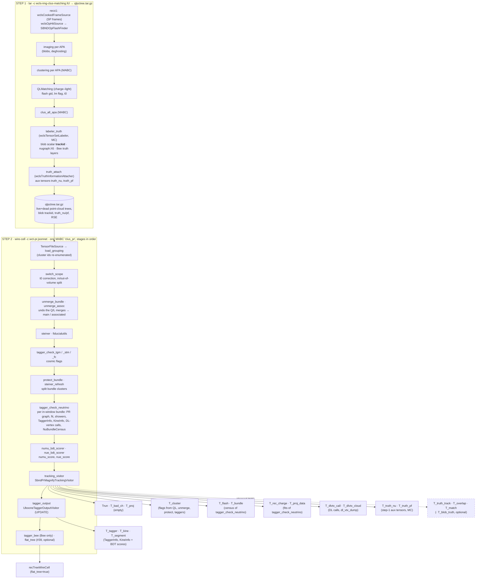
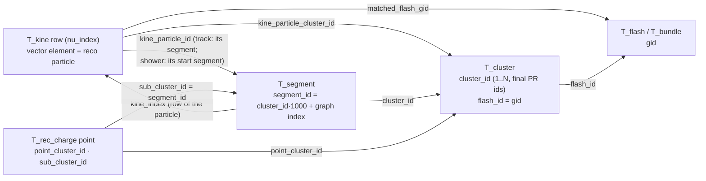
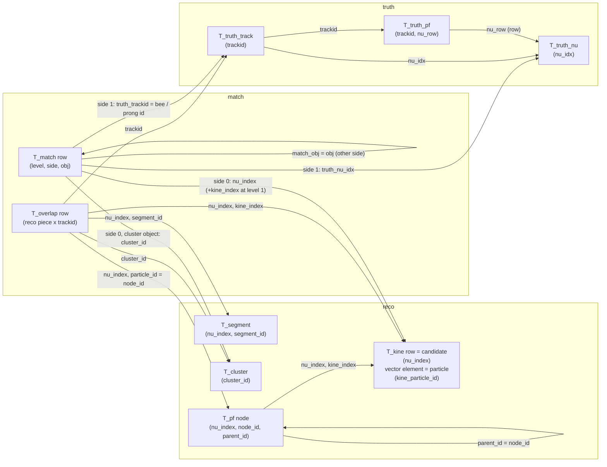
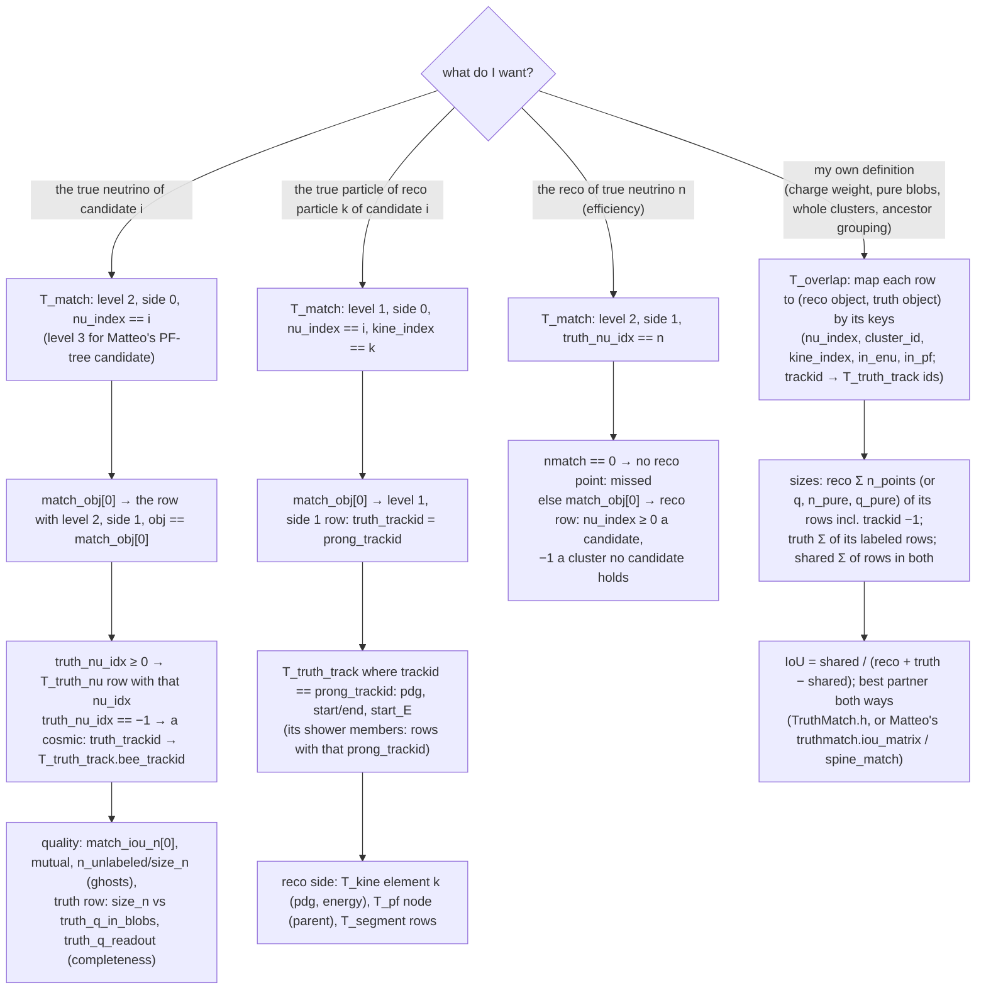

# 41 — SBND reco–truth matching at blob, cluster and particle level, in tracking-pr.root and the merged CAF

**Status (2026-10-13): implemented and validated on 113 r7 MC CV events + 50 data events. Pushed: toolkit `HaiwangYu/wire-cell-toolkit` `sbnd-wc-flatcaf` `229b7aab`, larwirecell `sbnd-wc-flatcaf` `73c79bc`, workflow `sbnd-wirecell-production` `31a079d`. Results in §7.** Decisions (Haiwang, 2026-10-12): change step 1; default interaction = the `T_kine` particles (PF tree flagged too); particle level and a particle-flow tree in ROOT; per-blob table off by default; pushes to the forks allowed.

The goal is a reco→truth match, and a truth→reco match, for SBND MC. It lives in `tracking-pr.root` (and so in the flat CAF's `recTreeWireCell`) and is computed inside the Wire-Cell chain. A user can then reproduce Matteo Vicenzi's bee-based matching from the ROOT file alone, and choose their own quality cuts without rerunning the chain.

Builds on #39 and #40 (the CAF merge), #35 (`T_dlvtx_*` with SCE-shifted truth vertices) and the larwirecell `TensorSetLabeler` (blob truth labels).

## 0. The request (Haiwang, 2026-10-12)

1. Understand the current `tracking-pr.root`:
   - every tree, and at which PR stage it is produced (a Mermaid diagram);
   - in particular, `T_kine.kine_particle_*` and how it relates to `T_cluster`.
2. Read Matteo's matching (`/exp/sbnd/app/users/mvicenzi/sbnd-wirecell/work/truthmatch.py`, which works from Bee plus `tracking-pr.root`). Work out what is needed to reach the same criteria from `tracking-pr.root` alone.
3. Add blob→truth-particle matching in step 1 (img-clus-match) and aggregate it to reco cluster→truth and particle→truth. Reco inefficiency and ghosts must be handled the way Matteo handles them. The goal is to reproduce his results, or come close.

Requirements:
- **Validation:** the other trees are unchanged, and Matteo's algorithm run on the new trees gives his bee-based result, identical or close.
- **Truth labeling:** use deposits plus the full pseudo-simulation (SCE, drift, diffusion, readout window).
- **Flexibility:** keep enough information that users can judge match quality and cut on it.
- **Size:** do not store the full set of Bee points.

## 0.5 Definitions and ids (agreed vocabulary, 2026-10-12)

| term | meaning | reco id in tracking-pr.root | truth id |
|---|---|---|---|
| **flash bundle** | one optical flash and the charge clusters Q/L-matched to it | `gid` (`T_flash`, `T_bundle`, `T_cluster.flash_id`, `T_kine.matched_flash_gid`) | — |
| **neutrino interaction / candidate** | one reconstructed interaction: one in-window flash bundle on which the neutrino PR ran | **`nu_index`** (`T_kine`, `T_tagger`, `T_segment`, `T_bundle`, `T_rec_charge`, `T_dlvtx_*`) | `T_truth_nu.nu_idx` (0-based); `T_truth_pf.nu_row` |
| **cluster** | one 3D charge cluster (connected blobs). **Neither an interaction nor a particle.** An interaction is a main cluster + companion clusters; one cluster usually holds several prongs of the interaction | `T_cluster.cluster_id` (final PR ids 1..N) | — |
| **segment** | one edge of the PR graph between two vertices: the finest reco unit with an id | `segment_id` = cluster_id·1000 + graph index (`T_segment`, `T_rec_charge.sub_cluster_id`) | — |
| **particle (prong)** | one reco particle with PID and energy: a track (one segment) or a shower (its segments) | (`nu_index`, row of the `T_kine` vectors); named by `kine_particle_id` (the track's or shower start's segment id) | `T_truth_pf.trackid` (a G4 particle) |
| **particle flow** | the mother–daughter tree of an interaction's particles, with PID and energy | **not in ROOT.** Built only for the Bee display (`fill_bee_pf_tree`, `MultiAlgBlobClustering.cxx:1422`, parent links :1635–1690; node id = 20000000 + segment_id). `T_kine` has PID and energy but no mother; `T_segment` has only start/end vertex ids | `T_truth_pf.mother_trackid` / `parent_trackid` (beam ν particles > 10 MeV only) |

**Two particle lists for one interaction.** `T_kine` is filled by the energy walk (`NeutrinoKinematics`; `T_segment.in_enu`). The particle-flow tree is built by a separate walk with different gates. Measured on Matteo's r7 tables:
- the two energy sums agree within 1 % for 34 % (CV) and 51 % (nueCC) of candidates;
- they differ by more than 10 % for 16 % of candidates in both samples.

**Candidates per event.**
- **By design:** one per in-window (0.2–2.2 µs) flash bundle that survives the cosmic vetoes (`nu_per_bundle`), with no hard cap.
- **In practice,** flashes are found per TPC, so mostly at most one per TPC.

| sample | events | 0 | 1 | 2 | 3 | true matchable ν ≥ 2 |
|---|---|---|---|---|---|---|
| open data (#40), real candidates (Enu > 0) | 89,921 | 55.3 % | 44.2 % | 0.52 % | 3 events | — |
| r7 MC CV (Matteo's table) | 13,112 | 54.0 % | 45.3 % | 0.71 % | 0 | 1.7 % |
| r7 MC nueCC | 8,877 | 5.2 % | 91.2 % | 3.5 % | 2 events | 6.9 % |

- Two candidates are usually two neutrinos, one per TPC. But one interaction near the cathode can make a flash in each TPC and so become two candidates (Matteo: 13 of 72 two-candidate events were nearest the same true interaction).

## 1. The current tracking-pr.root

Example: `production-prep/r7-r26-master-b7bd2a1a/mc-cv/f0000/pr/pr_evt2/tracking-pr.root`.
- Code: toolkit `sbnd-wc-flatcaf` `f6fd2209`.
- Joins measured on 1,212 mc-cv, 48 nueCC and 200 beam-on r7 events.

### 1.1 Where each tree comes from

### 1.2 The trees

`STV` = `root/src/SbndPrMagnifyTrackingVisitor.cxx`, `UTO` = `root/src/UbooneTaggerOutputVisitor.cxx`.

| tree | one entry is | data comes from (stage) | writer | MC/data | when |
|---|---|---|---|---|---|
| `Trun` | the event | config, census counters, provenance strings | STV `write_trun` | both | always |
| `T_bad_ch` | a dead-channel range (`chid`, `plane`, `start/end_time`) | step-1 dead grouping | STV `write_bad_channels` | both | always |
| `T_proj` | one empty entry, 0 branches | — (kept for old readers) | STV | both | always |
| `T_cluster` | **one PR cluster** (every live cluster, in-scope or not) | ids final after `protect_bundle`. Flags from QL (`lm`, `matched_flash_gid`), unmerge/protect (`is_main`, `is_associated`), `switch_scope` (`in_scope`, `cluster_t0_us`), taggers (`tgm`/`stm`/`fc`) | STV `write_cluster_summary` | both | always |
| `T_flash` | one optical flash (`gid`, `tpc`, `time_us`, `pe`, `in_window`, `n_matched_*`) | census of `tagger_check_neutrino` | STV | both | always |
| `T_bundle` | one in-window flash bundle (`gid`, `reason`, `nu_index`, `sel/final_cluster_id`, `n_*`) | census of `tagger_check_neutrino` | STV `write_nu_census` | both | bundles exist |
| `T_rec_charge` | **one fitted 3D point** of a candidate's PR graph (segment points and vertices) | `tagger_check_neutrino` fits, all candidates | STV `write_t_rec_data` | both | candidate (else 0 rows) |
| `T_proj_data` | one row; vectors per fitted cluster: 2D (channel, tick) charge, error, prediction | `tagger_check_neutrino` fits | STV `write_proj_data` | both | always (empty without a fit) |
| `T_dlvtx_call` | one DL-vertex network call (trad / rerank / dl / final vertex, decision, MC truth vertex SCE-shifted) | `tagger_check_neutrino` | STV `write_dlvtx` | both | `dl_vtx_dump=true` |
| `T_dlvtx_cloud` | one point of a call's network input | same | same | both | same |
| `T_truth_nu` | one true neutrino interaction (`nu_idx` 0-based, `pdg`, `ccnc`, `mode`, `E`, `vtx_*`, `t`, `edep`) | step-1 `truth_attach` → aux tensor | STV `write_truth` | MC | always on MC |
| `T_truth_pf` | one G4 particle from a beam neutrino with KE > 10 MeV (`trackid`, `parent/mother_trackid`, `pdg`, `E`, `KE`, start/end, `nu_row`) | same | same | MC | same |
| `T_tagger` | **one candidate** (`nu_index`): 1,246 tagger features, `numu/nue_score`, `act_*` roster | `TaggerInfo` + BDT scorers | UTO | both | candidate only |
| `T_kine` | **one candidate**: Enu, π0, excluded energy, and **one vector element per reco particle** | `KineInfo` (`fill_kine_tree`) | UTO | both | candidate only |
| `T_segment` | one segment of a candidate's PR graph (`segment_id`, `cluster_id`, `shower_id`, `in_enu`, `kine_index`, `pdg`, `length_cm`, `ke_mev`) | candidate graph + `KineInfo` links | UTO `fill_links` | both | candidate only |

MC has 12 trees without a candidate and 15 with one. Data has 10 and 13.

### 1.3 Ids, and `T_kine.kine_particle_*` vs `T_cluster`

- **Cluster ids** are re-numbered 1..N after every stage, so `T_cluster.cluster_id` are the final PR clusters, after `switch_scope`, both unmerges and `protect_bundle`. They are **not** the step-1 ids, and no tree maps them to step 1 or to blobs. No stage after `steiner_refresh` changes clusters, so ids stored by `tagger_check_neutrino` equal the writers' ids.
- **One `kine_particle_*` element is one reco particle:** either one track segment or one whole shower. In mc-cv: 1,311 track rows, 4,174 shower rows.

  | branch | meaning |
  |---|---|
  | `kine_energy_particle` | kinetic energy, MeV |
  | `kine_energy_info` | how it was measured: 0 dQ/dx, 1 range, 2 charge |
  | `kine_particle_type` | PDG |
  | `kine_energy_included` | the walk's flag (1, or 3 for a connection-type-3 shower). Every row is summed into `kine_reco_Enu` regardless |
  | `kine_particle_id` | `cluster_id·1000 + segment index` of the track, or of the shower's start segment |
  | `kine_particle_is_shower` | 1 for a shower |
  | `kine_particle_cluster_id` | the PR cluster of that (start) segment, a `T_cluster.cluster_id` |
  | `kine_particle_nseg` | 1 for a track, the number of member segments for a shower |
  | `kine_particle_pool` | which pass added it: 0 main-vertex edge, 1 BFS, 2 leftover shower, 3 orphan, 4 guard-freed, 5 near cross-cluster |

- **Measured joins:**
  - `kine_particle_cluster_id` ∈ `T_cluster` (100 %), and equals `kine_particle_id // 1000` (100 %).
  - (`nu_index`, `kine_particle_id`) ∈ `T_segment.segment_id` and ∈ `T_rec_charge.sub_cluster_id` (100 %).
- **A candidate spans several clusters:** only 1,393 of 4,560 mc-cv particles sit on the main cluster (`T_kine.cluster_id`); the rest are on the bundle's companion clusters.
- **`T_rec_charge` ids:**
  - `cluster_id` is the candidate's main cluster, the same on every row.
  - `point_cluster_id` is the point's own PR cluster.
  - `real_cluster_id` and `sub_cluster_id` are the same value, the `segment_id` (−1 on vertex rows).
  - `particle_id` is the segment PDG.
  - (`tracking-pr_trees.md` in Matteo's repo calls the `//1000` value an "origin cluster of a merged object". It is the point's own PR cluster.)

### 1.4 Truth already in the chain

| what | where | reaches tracking-pr.root? |
|---|---|---|
| one dominant G4 `trackid` per **blob** | step-1 `labeler_truth`, blob `scalar` PC, **inside `qlpctree.tar.gz`** (r7 mc-cv f0000: 87.9 % of blobs, 98.1 % of blob charge labeled) | no; nothing in `clus/` or `root/` reads it |
| `truth_nu`, `truth_pf` | step-1 `truth_attach` → aux tensors | yes: `T_truth_nu`, `T_truth_pf` |
| `truth_per_track` (labeler) | in the tar | no (not in `aux_datatypes`) |
| SCE-shifted true vertex | `T_dlvtx_call.truth_*` | yes, for candidates with a DL call |

The labeler's **pseudo-simulation**, configured in `wcls-img-clus-matching-pr-lib.jsonnet:429-453`, `TensorSetLabeler.cxx:843-1208`:
- **Input:** `ionandscint:priorSCE` deposits.
- **SCE:** shifted true→reco with the TrueFwd map.
- **Drift:** using each deposit's own G4 time, so out-of-time cosmics land correctly.
- **Smearing:** longitudinal and transverse diffusion (`sqrt(2Dt)`) plus SP filter smearing.
- **Matching:** a deposit counts for a blob within (1 wire, 2 ticks) + 3σ of the blob's wire and tick bounds.
- **Label:** the blob gets the trackid with the most electrons. `abs(TrackID)` folds unsaved descendants into their saved ancestor.
- **Readout window:** applied only to the `sed-*` Bee layers, not to blob labeling.
- **Stored per blob:** only `trackid`, no purity.

## 2. Matteo's matching (Step 2 of the request)

Code: `work/truthmatch.py` (195 lines) and `work/wcreco.py`. Docs: `docs/point_labelling.md`, `docs/matching_and_efficiency.md`, and his own proposal `docs/toolkit_truth_match_plan.md`. Results on our r7: `work/out/r7/{bnb,nuecc}/reco_candidates_*.csv` (bnb: 6,130 candidates, 6,077 matched).

### 2.1 The algorithm (SPINE's `MatchProcessor` rule)

| element | definition | source today |
|---|---|---|
| points | every **imaging point** of every cluster (in-scope or not); q = mean wire charge over live planes (`MultiAlgBlobClustering.cxx:3291`) | Bee `img-global` (step 1) |
| point truth | the point's **blob** label: G4 track, or none (= ghost or labeler miss) | Bee `truth_trackid_labeled` / `truth_unlabeled`, joined on rounded (x, y, z) |
| track → neutrino | `nu_idx`: k ≥ 1 neutrino k, 0 not from a beam neutrino | Bee `sed-smear_readout` |
| point → PR cluster, → segment | joined on (y, z, q), then on PR (x, y, z) | Bee `clustering-pr-global`, `shower_track-global` (step 2) |
| truth objects | one per neutrino (`nu<k>`), one per non-beam G4 track (`cosmic<trackid>`) | — |
| reco objects | `cand<i>` = points of the segments in candidate i's **particle-flow tree** (the Bee `mc.json` `nu K` subtree, minus pseudo-particles); `pr<c>` = the rest of PR cluster c; `img<c>` = an imaging cluster with no PR counterpart | Bee `mc.json` + `T_rec_charge` |
| overlap | IoU = \|r∩t\| / (\|r\|+\|t\|−\|r∩t\|) in points (or charge). **\|r\| includes unlabeled points**, so ghosts lower a reco object's IoU; \|t\| counts only that truth object's labeled reco points | — |
| match | each reco object's best truth and each truth object's best reco, independently, above `min_overlap` (0); `mutual` where they agree | — |

**How imperfection is handled:**
- **Ghosts:** unlabeled points are counted in \|r\|.
- **Reco inefficiency:** truth deposits that made no blob are simply absent from \|t\|. This is SPINE's choice, since the truth is "adapted" onto reco points.
- **Splitting:** truth→reco takes the best object and reports its IoU.
- **Merging:** reco→truth takes the best truth and reports its IoU.
- **Cuts:** none in the loop; IoU, shared counts and `mutual` are written per row.

### 2.2 What `tracking-pr.root` would need, against what exists

| needed | in memory at `tracking_visitor`? | in the file today? |
|---|---|---|
| per imaging point: its blob's trackid | yes: `cluster->children()` blobs carry `trackid`; `blob_with_point(i)` | no |
| per imaging point: its PR cluster | yes (the grouping) | no (only counts in `T_cluster.npoints`) |
| per imaging point: its segment | yes: `seg->global_indices("associate_points")` per candidate graph (what the Bee `shower_track` layer dumps) | no (`T_rec_charge` is the fit cloud, a different point set) |
| the candidate's particle-flow segment set | yes (the same code builds the Bee `mc.json` tree) | partly (`T_segment.in_enu` is the `T_kine` set; the PF tree applies different gates) |
| trackid → `nu_idx` for every labeled track | **no**. `T_truth_pf` holds only beam-ν particles with KE > 10 MeV; on r7, 9.5 % of ν-labeled blobs carry a lower-KE trackid. The labeler's ν-trackid set is not serialized | no |
| Michel electron merged into its muon | no. The **Bee label is Michel-merged; the blob scalar is not** | no |

**What blocks reproducing Matteo's result from ROOT alone:**
1. the trackid → `nu_idx` map, which needs the step-1 labeler;
2. the per-point reco and truth labels, which can be aggregated in step 2 (no per-point storage needed);
3. the PF-tree candidate definition, which can be flagged in step 2;
4. the Michel merge convention, available if the labeler exports it.

### 2.3 Matteo's limits, and the goal here (Haiwang, 2026-10-12)

Reproducing Matteo is not the goal. The goal is the **best reco–truth match**, for evaluation and for particle-level ML training. Where his method has a limit that can be lifted, it is lifted, and the difference from him is stated.

| Matteo | limit | here |
|---|---|---|
| truth objects: whole neutrino interactions + one per cosmic G4 track | **no particle-level truth** | adds reco particle ↔ true particle (prong), with the truth hierarchy |
| reco object: the PF-tree segments of a candidate | one of two particle lists, not the one `kine_reco_Enu` uses; the PF tree is not in ROOT | both lists flagged; the particle-flow tree written to ROOT (new tree, mother index per particle) |
| one dominant G4 track per blob | shared blobs (vertex region, overlaps) go to one track | dominant + second track and purity per blob; cuts possible |
| point counts as the weight | sampling-density bias | charge too (reco charge ↔ true electrons), both stored |
| \|t\| = labeled reco points of the object | reco inefficiency invisible | true charge in the readout and in blobs per track: completeness |
| cosmic = one G4 track | a cosmic's delta rays and Michel are separate objects | grouped by ancestor too |
| Bee joins on rounded coordinates | lossy | identity joins in memory |

## 3. Design (Step 3)

### 3.1 Step 1, the larwirecell labeler (`wclsTensorSetLabeler`, MC only)

Nothing changes in the reco: the labeler runs after `clus_all_apa`. What's added is extra arrays written to the blob `scalar` PC and one aux tensor.

**Per blob, next to `trackid`:**

| scalar | meaning | why |
|---|---|---|
| `trackid` | dominant G4 track (unchanged) | |
| `truth_q` | electrons of all deposits accepted for this blob (after SCE, drift, diffusion, SP smearing, 3σ) | blob completeness and ghost tests |
| `truth_q_dom` | electrons of the dominant track | **purity** = `truth_q_dom/truth_q`, for quality cuts |
| `trackid2`, `truth_q2` | the second track | blobs shared by two particles (e.g. at a vertex) |

**One per-event aux tensor `truth_track`**, one row per G4 track that deposited inside the readout window:

| column | meaning |
|---|---|
| `trackid` | as on blobs (`abs(TrackID)`) |
| `nu_idx` | 0-based `T_truth_nu.nu_idx`; −1 if not from a beam neutrino. **Fills the gap of `T_truth_pf`** |
| `bee_trackid` | the Michel-merged id the Bee layers use (Matteo's convention) |
| `ancestor_trackid` | the primary, for SPINE-style grouping of a cosmic's secondaries |
| `pdg`, `mother_trackid` | from MCParticle |
| `q_readout` | electrons inside the readout window after the full pseudo-sim: the truth-side size in charge, for completeness |
| `q_in_blobs` | the part of `q_readout` accepted by some blob |

Both reach step 2 by adding `truth_track` to `aux_datatypes`, the path `truth_nu` and `truth_pf` already use.

**Readout window:** apply the `sed-*` readout window to `q_readout` (blob labeling is already bounded by the blobs' own ticks).

### 3.2 Step 2, the toolkit matcher (MC only, a knob, default off)

- **Pure computation**, no ROOT: `clus/inc/WireCellClus/TruthMatch.h`, with doctests. It:
  - accumulates the overlaps;
  - builds the reco and truth objects;
  - computes IoU and the SPINE argmax in both directions.
- **Gathering:** `SbndPrMagnifyTrackingVisitor` (knob `save_truth_match`, jsonnet TLA `truth_match`). Nothing is written when no blob carries `trackid` (data). It walks:
  - every cluster;
  - its default-scope points;
  - `blob_with_point` → the blob's labels;
  - `associate_points` of every candidate graph → segment;
  - segment → `T_kine` particle (`KineSegmentLinks`) and PF-tree membership.
  - The point weight is the same q as the Bee `img-global` point.

**New trees.** All are small and flat, and nothing per point:

| tree | one entry is | columns | size |
|---|---|---|---|
| `T_truth_track` | one truth track (from `truth_track`) | as in 3.1 + `n_points`, `q_points` (its labeled reco points) | ~10²/event |
| `T_overlap` | one (reco piece × trackid) pair, the **sufficient statistics** | piece = (`nu_index`, `cluster_id`, `segment_id`, `kine_index`, `in_pf_tree`); `trackid` (−1 = unlabeled); `n_points`, `q`, and quality-split sums `n_points_pure`/`q_pure` (blobs with purity ≥ 0.5) | ~10²–10³/event |
| `T_match` | one reco or truth object at one level | `level` (cluster / particle / candidate), `direction`, `object_id`, `size_n`, `size_q`, `n_unlabeled`, top-3 partners (`match_id[3]`, `iou_n[3]`, `iou_q[3]`, `n_shared[3]`), `mutual` | ~10²/event |
| `T_blob_truth` (**optional**, knob, default off) | one blob | `cluster_id`, `npoints`, `q`, `trackid`, `purity`, `trackid2` | ~4×10³/event, ~+10 % file |

**The three levels in `T_match`:**
- **cluster:** reco object = a `T_cluster` row.
- **particle:** reco object = a `T_kine` vector element; a shower is the union of its segments.
- **candidate:** reco object = Matteo's: the PF-tree segments of `nu_index` i, with the remainder per cluster.

For truth objects, `nu_idx` groups a neutrino's tracks; non-beam tracks are grouped by `bee_trackid` (default, as Matteo) or by `ancestor_trackid`, written both ways.

**Flexibility without rerunning:** from `T_overlap` plus `T_truth_track` a user can recompute every IoU with different choices:
- a different object definition (`in_enu` instead of the PF tree, whole clusters);
- charge instead of points;
- pure blobs only;
- truth grouping by ancestor;
- completeness against `q_readout` (reco inefficiency).

`T_match` stores the default answer, so most users need nothing else.

### 3.3 The merged CAF

`RootFlatTreeVisitor` (#39) flattens every tree of `tracking-pr.root`, so the new trees reach `recTreeWireCell` without code changes. The fixed schema (`aurora/schema/recTreeWireCell.schema.json`) must be regenerated with `make-schema.py` (#39 gate G5). That gives a new md5, which `merge-caf.py` checks.

## 4. Validation

| # | check | how | pass |
|---|---|---|---|
| V1 | the reco is untouched | rerun step 1 + step 2 on r7 MC units (mc-cv f0000–f0019, nueCC f0000–f0009, ~300 events) with the new labeler and `truth_match=true`; compare every value of every old tree with r7, and the old arrays of `qlpctree.tar.gz` | identical (by content, not bytes) |
| V2 | data unaffected | the same on 2 beam-on units | identical, no new trees |
| V3 | labels consistent with Bee | per event: labeled + unlabeled point counts in `T_overlap` = `truth_trackid_labeled` / `truth_unlabeled` of the new step-1 zip; each segment's `n_points` = its `shower_track-global` count; every labeled trackid in `T_truth_track` | exact |
| V4 | **Matteo from ROOT alone** | a reader (ai-helper `scripts/`) builds Matteo's point frame from `T_overlap` and calls his `truthmatch` functions unchanged; compare per candidate with `work/out/r7/bnb` and `nuecc` (`ct_match`, `ct_iou`, `ct_n`, `ct_n_unlabeled`, `ct_n_shared`, `ct_mutual`, `nu_ct_*`) | identical, except where his Bee joins report problems (each listed with its reason) |
| V5 | `T_match` = V4 | the toolkit's own result vs the Python result on the same file | identical |
| V6 | merged CAF | `run-pairs.sh` on 2 MC pairs with the new schema; `validate-merge.py` PASS | PASS |
| V7 | cost | added time and file size in step 1 and step 2 | < 2 % time, file size reported |

## 5. Phases

1. **Labeler** (larwirecell, new branch from `sbnd-wc-flatcaf`):
   - the per-blob scalars and the `truth_track` tensor;
   - build and deploy to `opt` (with a backup);
   - check V3 on 1 unit.
2. **Toolkit** (new branch from `sbnd-wc-flatcaf`):
   - `TruthMatch.h` + doctests;
   - the visitor knob and trees;
   - the jsonnet TLA;
   - `aux_datatypes` += `truth_track`;
   - the step-2 cfg-proof: with the knob off, the compiled config is byte-identical.
3. **Python reader + comparison** (ai-helper `issues/41-*/scripts/`): V4, V5.
4. **Validation run** V1–V3 and V6 on ~300 MC and 2 data units, at ≤ 50 % of sbndbuild03.
5. **CAF:** schema regenerated, `aurora/` README and AGENTS updated, doc finished.

## 6. Questions and limits

**Decisions for Haiwang:**
1. **Step 1 must change, so validation reruns step 1.** The `nu_idx` of every labeled track, the Michel merge and the purity exist only in the labeler. A step-2-only version on the existing r7 tars is possible, but its `nu_idx` would be wrong for the ~10 % of neutrino-labeled blobs whose track is below 10 MeV (they would look like cosmics). Proposal: change step 1.
2. **Candidate definition** for the default `T_match` candidate level: Matteo's PF tree (reproduces him), or `T_kine`'s set (`in_enu`). Proposal: the PF tree as the default, with both flags in `T_overlap`.
3. **Cosmic truth grouping** default: per Michel-merged track (Matteo), or per ancestor (SPINE). Proposal: Matteo's as the default, both stored.
4. **`T_blob_truth`:** off by default (≈ +10 % file size)?
5. **Pushes:** may I push the new larwirecell and toolkit branches to your forks (as for #39)?

**Limits, and what cannot be exact:**
- **Matteo's Bee joins are lossy** (rounded coordinates, duplicate keys popped in order); his `point_truth` problem counters record it. The new trees join by object identity, so they can only agree where his joins succeeded. Every difference will be listed against his counters.
- **Reco inefficiency cannot enter a point IoU.** A deposit that made no blob has no reco point. As in SPINE, \|t\| counts labeled reco points. `q_readout` and `q_in_blobs` give the truth-side completeness that point IoU cannot.
- **A blob carries one dominant label**, as today. Points of a blob shared by two particles all go to the dominant one; `trackid2` and purity expose it, but the IoU stays blob-granular.
- **Data:** no truth, no new trees.

## 7. Implementation and validation (2026-10-13)

### 7.1 What was built

| where | change |
|---|---|
| larwirecell `TensorSetLabeler` (`73c79bc`) | config `truth_detail` (default false): per-blob `truth_q`, `truth_q_dom`, `trackid2`, `truth_q2`; per-event tensor `truth_track` (datapath `truthtrack/<ident>`): `trackid, nu_idx, bee_trackid, ancestor_trackid, prong_trackid, pdg, mother_trackid, mother_pdg, process, q_readout, e_readout, q_in_blobs, n_blobs_dom, q_dom_blobs, start_*/end_*`. A prong folds an EM daughter of an EM particle, a delta electron (`eIoni/muIoni/hIoni/ionIoni`) and a muon's radiative e/γ (`muPairProd/muBrems`) into its mother; a Michel stays its own prong |
| toolkit `clus/TruthMatch.h` (+ doctest, 3 cases / 22 assertions) | the SPINE rule on shared reco points: IoU in points and charge, both directions, top-k, ties by charge IoU then lower index, `mutual` |
| toolkit `MultiAlgBlobClustering` | publishes every candidate's Bee particle-flow tree on the Ensemble (aux tensor `pf_tree:mc`, metadata only, Bee output unchanged); `aux_datatypes` += `truth_track` |
| toolkit `SbndPrMagnifyTrackingVisitor` (`root/src/SbndPrTruthMatch.cxx`) | knob `truth_match` (+ `blob_truth`, `truth_match_topk` 3, `pure_blob_min` 0.5): `T_truth_track`, `T_overlap`, `T_match`, `T_pf` (+ `T_blob_truth`); nothing without a `truth_track` table (data) |
| cfg | `wct-pr.jsonnet` TLAs `truth_match`, `blob_truth` (default false); step-1 `labeler_truth` `truth_detail: true` |
| workflow `aurora/` (`31a079d`) | `step2.sh` turns `truth_match` on for sim (`WC_TRUTH_MATCH=0` off); schema 2,401 branches / 20 trees, md5 `d4396a3490ea` (the #39 schema kept as `...v1-c845fe94fbe5.json`) |

**The trees** (one file per event; MC only):
- `T_truth_track`: the labeler table as is. Mean 354 rows per event.
- `T_overlap`: one row per (reco piece × `trackid`) with `n_points`, `q` (the Bee per-point charge, mean over live planes), and `n_pure`/`q_pure` (blobs of purity ≥ 0.5). Mean 81 rows per event.
  - A piece is (`nu_index`, `cluster_id`, `segment_id`, `particle_id`, `kine_index`, `in_enu`, `in_pf`).
  - The rest of a cluster has `nu_index = segment_id = −1`.
  - `trackid` −1 marks unlabeled points; `nu_idx` −2 then.
  - Point → segment uses `associate_points`, the same as the Bee `shower_track` layer. A point claimed by two candidates goes to the first.
- `T_match`: one row per object, `level` 0–3 × `side`. Mean 444 rows per event.
  - Columns: `size_n/q`, `n_unlabeled/q_unlabeled` (reco), `truth_q_readout/truth_q_in_blobs` (truth), up to 3 partners (`match_obj`, `match_iou_n`, `match_iou_q`, `match_shared_n/q`), `mutual`.
  - Truth objects not from a neutrino and holding no reco point are not written (they were 65 % of the rows); `obj` keeps the full-list index.
- `T_pf`: one row per node of each candidate's reco particle-flow tree, with `parent_id` (−1 = attached to the neutrino vertex), `depth`, `name`, `pdg`, `ke_mev`, `is_pseudo` (a γ, n or π0 carrier with no reco segment), `kine_index`, start and end.

**How to read a match.**
- A candidate's best true interaction: `T_match` rows with `level==2`, `side==0`, `nu_index==i`; `match_obj[0]` is the `obj` of a `level==2`, `side==1` row, whose `truth_nu_idx` is the `T_truth_nu.nu_idx` (−1 and `truth_trackid` = the Michel-merged id for a cosmic).
- The same for particles with `level==1`: reco `kine_index` is the `T_kine` vector element, truth `truth_trackid` is the prong's G4 track.
- Any other choice can be recomputed from `T_overlap` + `T_truth_track`.

### 7.2 Validation

Sample: r7 MC CV units f0000, f0011–f0016 (7 reco1 files, 113 events) with their CV flat CAFs. Rerun through all three steps with the new builds (`production-prep/truthmatch-41/run/`, everything kept). Data: one open-data pair of #40 (50 events, `run-data/`). Script: `scripts/val41.py`.

| # | check | result |
|---|---|---|
| V1 | every tree of r7's `tracking-pr.root`, every value | **identical** in 113/113 events: 1,312,718 values, 0 differences. Only new branch `Trun.input_file` (#39) |
| V1b | step-1 `qlpctree.tar.gz` vs r7, keyed by datapath | **0 changed arrays**; new tensors are exactly `truth_q`, `truth_q_dom`, `trackid2`, `truth_q2`, `truthtrack` per event; set metadata gains only `input_file` (#39) |
| G3 | compiled config vs the committed cfg | step 2 byte-identical with the knobs off (sim and data); step 1: of 196 nodes only `labeler_truth.truth_detail` differs (sim and data) |
| V2 | data pair vs its #40 production | step-1 arrays unchanged, 0 new tensors; no truth-match tree in any of 50 events; 114,150 Wire-Cell values in the merged CAF identical apart from `Trun.input_file` (the work-dir path of the FrameShift copy, see 7.3) |
| V3 | `T_overlap` vs the step-1 Bee truth layers | 113/113 events: total points = `truth_trackid_labeled` + `truth_unlabeled`; labeled points equal; points per Michel-merged track equal |
| V4 | Matteo's r7 table (`work/out/r7/bnb/reco_candidates_20261009_183434.csv`, `ct_*`) vs `T_match` level 3 | 63 candidates: **same matched truth 63/63**, same size and IoU 62/63, IoU within 0.01 63/63. The one difference (719/45/17 nu0: 2,196 vs 2,198 points, IoU 0.8896 vs 0.8905) is an event his own check flags: "particle-flow segments [11011] hold no imaging points" -- his coordinate join lost them; the new trees take them from the segment's point indices |
| V5 | Matteo's `truthmatch.iou_matrix` + `spine_match` (unchanged, imported) on `T_overlap` vs `T_match` | 63/63 identical (truth label, IoU to float precision) |
| V6 | merged CAF (new schema) | 7/7 pairs `OK`, `validate.json` PASS |
| V7 | cost | step 2 +1 % CPU, +70 MB RSS (same tar, truth match off/on, twice each); new trees 45.6 kB/event in `tracking-pr.root` (mean file 638 kB, ≈ +7 %: `T_truth_track` 28.6, `T_match` 13.1, `T_overlap` 3.0, `T_pf` 1.0); merged CAF `recTreeWireCell` 98 kB/event next to `recTree` 678 kB/event. Step 1: the labeler's extra work is O(depos + blobs), not separately measured |

**An example** (r7 719/1/2, two candidates):
- Candidate-level IoU: 0.985 (`nu_index` 0 → ν 1) and 0.878 (`nu_index` 1 → ν 0), both mutual.
- Particle level: 10 of 12 `T_kine` particles have a mutual best prong. The best IoU ranges from 0.009 (a 14-point particle) to 1.0.
- Candidate 1's particle flow in `T_pf`: two shower electrons hang under the μ⁻; a π⁺ carries a pseudo-neutron, with a μ⁻ track below it.

### 7.3 Left over

- **The `input_file` of data CAFs (#40, found here):** step 1 reads the FrameShift copy, so `Trun.input_file` is the copy's local path (`<work>/<id>/fs/<reco1 stem>_frameshift.root`), not the /pnfs reco1. The reco1 is still identifiable (the name, and `pairs.tsv`). Fix options: give the attacher an override (larwirecell), or rewrite the value at merge time.
- **Step-1 cost** of `truth_detail` is not isolated (it runs inside the one art module).
- **A blob carries one dominant label**: purity and the runner-up are stored, but the IoU stays blob-granular.
- **Particle level vs Matteo:** he has no particle level, so V4/V5 cover the interaction level only. Particle level is validated by construction (the same `T_overlap`) and by V3, not against an independent reference.

## 8. Reference: the new trees

### 8.1 `T_truth_pf` and `T_truth_track`

They are two different truth tables, made by two different step-1 modules.

| | `T_truth_pf` | `T_truth_track` |
|---|---|---|
| made by | larwirecell `wclsTruthInformationAttacher` (#33) | larwirecell `wclsTensorSetLabeler`, `truth_detail` (#41) |
| purpose | the **generator-side particle flow**: what each beam-neutrino interaction produced | the **truth inventory of the charge**: every particle that left charge where Wire-Cell could see it, the truth side of every match |
| rows | G4 particles **from a beam neutrino** with **KE > 10 MeV**, whether or not they deposit charge | G4 particles **of any origin** (beam neutrino, cosmic, anything) with charge **inside the readout window** after the pseudo-simulation, or dominating a blob |
| cosmics | none | yes (`nu_idx` −1) |
| low-energy particles | none below 10 MeV | all |
| neutrino key | `nu_row` = row of `T_truth_nu` | `nu_idx` = `T_truth_nu.nu_idx` |
| content | kinematics: `E`, `KE`, start and end position and time, start momentum, `parent_trackid` (nearest kept ancestor), `mother_trackid`, `process` | charge: `q_readout`, `e_readout`, `q_in_blobs`, `n_blobs_dom`, `q_dom_blobs`; the grouping ids `bee_trackid`, `ancestor_trackid`, `prong_trackid`; start and end, `start_E` |
| per event (113 r7 CV events) | 21 rows | 354 rows (123 from neutrinos, 231 not) |

- **The same `trackid`** (G4 `MCParticle::TrackId`) in both. 3.6 rows per event are in both, and those 412 tracks agree on the interaction 412/412.
- **They carry the same charge**: the tracks in both hold **94 %** of the neutrino charge in the readout window.
- **Most `T_truth_pf` rows (17.6 of 21) have no charge in the readout.** The rockbox events carry several neutrino interactions, most outside the detector, and a neutron deposits nothing itself.
- **Most neutrino rows of `T_truth_track` (119 of 123) are not in `T_truth_pf`.** They are below 10 MeV (Compton electrons, nuclear fragments, delta rays). They matter for matching: 5.8 per event dominate at least one blob.
- The 125 interactions with `edep > 0` in `T_truth_nu` are exactly the 125 with charge in `T_truth_track`.

Use `T_truth_pf` for what was produced (kinematics), `T_truth_track` for what Wire-Cell saw (matching, completeness).

### 8.2 Branches

Every tree starts with `runNo`, `subRunNo`, `eventNo`. Units:
- positions cm, times ns, `start_E` GeV;
- `e_readout` and `ke_mev` MeV;
- **true charge in electrons** (`SimEnergyDeposit::NumElectrons`, the labeling weight; `Energy()` in MeV for a deposit with 0 electrons);
- **reco charge in electrons** (the imaging charge).

**`T_truth_track`**: one row per G4 track with charge inside the readout window or dominating a blob.

| branch | type | definition |
|---|---|---|
| `trackid` | I | G4 track id = \|SED `TrackID`\|. larg4 gives an unsaved descendant's deposits (delta rays, shower electrons) the negative of its saved ancestor's id, so they count under that ancestor |
| `nu_idx` | I | the beam-neutrino interaction it comes from, = `T_truth_nu.nu_idx` (the generator MCTruth index); −1 not from a beam neutrino (cosmic, ...) |
| `bee_trackid` | I | a Michel electron's mother muon, else `trackid`. The id the Bee truth layers show, and Matteo's cosmic objects |
| `ancestor_trackid` | I | the topmost stored ancestor (following `Mother()` while the mother is a stored MCParticle): the generator particle or the cosmic primary |
| `prong_trackid` | I | the particle a reco particle is compared with. Folded into the mother: an e±/γ whose mother is e±/γ (a shower is one prong); an ionization electron (`eIoni`, `muIoni`, `hIoni`, `ionIoni`); a muon's `muPairProd`/`muBrems` e/γ. A Michel electron is its own prong |
| `pdg` | I | PDG code |
| `mother_trackid` | I | `MCParticle::Mother()` (0 or the generator offset for a primary) |
| `mother_pdg` | I | the mother's PDG, 0 if not stored |
| `process` | I | G4 creation process, `aiml/G4ProcessCode.h`: 0 primary, 1 Decay, 2 eIoni, 3 muIoni, 4 eBrem, 5 compt, 6 phot, 7 conv, 8 hIoni, 9 nCapture, 10 muPairProd, 12 muBrems, …, 10001 Michel |
| `q_readout` | D | electrons of its deposits inside the **readout window**: SCE true→reco shift, drift with the deposit's own time, readout cut on the drift time, as for the `sed-*` Bee sets |
| `e_readout` | D | the same deposits in energy, MeV |
| `q_in_blobs` | D | electrons of its deposits **accepted by at least one blob**: within (1 wire, 2 ticks) + 3σ of diffusion and SP smearing of the blob's wire and tick bounds. `q_in_blobs/q_readout` is the true particle's imaging completeness |
| `n_blobs_dom` | I | blobs of which it is the dominant track (the blob `trackid`) |
| `q_dom_blobs` | D | its accepted electrons summed over those blobs |
| `start_x/y/z`, `start_t` | D | true start of the trajectory (no SCE) |
| `start_E` | D | total energy at start, GeV |
| `end_x/y/z` | D | true end of the trajectory |

**`T_overlap`**: one row per (reco piece, true track) that share imaging points. Together they cover every imaging point of the event (Σ `n_points` = Σ `T_cluster.npoints`).

| branch | type | definition |
|---|---|---|
| `nu_index` | I | the candidate (`T_kine`/`T_tagger` row) whose PR graph claims the points; −1 = no candidate (the rest of the cluster) |
| `cluster_id` | I | the `T_cluster.cluster_id` holding the points |
| `segment_id` | I | `cluster_id·1000 + graph index` of the claiming segment, = `T_segment.segment_id` = `T_rec_charge.sub_cluster_id`; −1 for the rest |
| `particle_id` | I | the particle-flow id of the segment's particle: the shower's start segment for a shower member, else the segment itself. = `T_kine.kine_particle_id` = `T_pf.node_id` = Bee `shower_track` id; −1 for the rest |
| `kine_index` | I | the `T_kine` vector element (reco particle) the segment belongs to; −1 if its energy is not in `kine_reco_Enu`, or for the rest |
| `in_enu` | I | 1 if the segment is in `kine_reco_Enu` (= `T_segment.in_enu`, `kine_index ≥ 0`) |
| `in_pf` | I | 1 if its particle is a node of the candidate's particle-flow tree (`T_pf`, Bee `mc`) |
| `trackid` | I | the dominant true track of the blob the points belong to (`T_truth_track.trackid`); **−1 = unlabeled** (ghost, or a labeler miss) |
| `nu_idx` | I | that track's interaction (`T_truth_track.nu_idx`); −1 not from a neutrino, −2 unlabeled |
| `n_points` | F | imaging points: the cluster's default-scope points = the blobs' sampling points = the Bee `img` points |
| `q` | F | their reco charge: per point, the mean of its wire charges over the non-dead planes (the Bee per-point charge) |
| `n_pure`, `q_pure` | F | the part from blobs of purity ≥ `pure_blob_min` (0.5): `truth_q_dom/truth_q` of the blob |

Segment → points is the segment's `associate_points` (what the Bee `shower_track` layer draws). A point claimed by two candidates goes to the first `nu_index`.

**`T_match`**: one row per reco or truth object at one level, with up to 3 partners.

| branch | type | definition |
|---|---|---|
| `level` | I | 0 **cluster**: reco = a `T_cluster` cluster, truth = an interaction or a non-neutrino object. 1 **particle**: reco = a `T_kine` vector element (the rest of each cluster is one object), truth = a prong (`prong_trackid`). 2 **candidate**: reco = a candidate's `in_enu` segments (the `T_kine` particles; the rest per cluster), truth = interaction or non-neutrino object. 3 **candidate (PF)**: as 2 with the particle-flow tree's segments (`in_pf`), Matteo's definition |
| `side` | I | 0 reco object, 1 truth object |
| `obj` | I | the object's index within (`event`, `level`, `side`); partners name it |
| `nu_index` | I | reco: the candidate (levels 1–3); −1 for a cluster object; truth: −1 |
| `cluster_id` | I | reco: the cluster of a cluster or rest-of-cluster object; else −1 |
| `kine_index` | I | reco, level 1: the `T_kine` vector element; else −1 |
| `truth_nu_idx` | I | truth: the interaction (`T_truth_nu.nu_idx`), also for a prong (from its member tracks); −1 for a non-neutrino object; reco: −1 |
| `truth_trackid` | I | truth, levels 0/2/3: −1 for an interaction, the `bee_trackid` of a non-neutrino object. Level 1: the `prong_trackid`. Reco: −1 |
| `size_n`, `size_q` | F | the object's points and charge. A reco object counts its unlabeled points; a truth object its labeled reco points |
| `n_unlabeled`, `q_unlabeled` | F | reco: its unlabeled points and charge (the ghosts); truth: 0 |
| `truth_q_readout`, `truth_q_in_blobs` | F | truth: Σ of the member tracks' `q_readout` / `q_in_blobs` (all members, also those with no reco point); reco: 0 |
| `nmatch` | I | partners stored (≤ 3, each sharing ≥ 1 point) |
| `match_obj` | vector<int> | the partners' `obj` on the other side of the same level, by decreasing `match_iou_n` (ties: `match_iou_q`, then lower `obj`) |
| `match_iou_n`, `match_iou_q` | vector<float> | IoU in points and in charge: \|r∩t\| / (\|r\|+\|t\|−\|r∩t\|) |
| `match_shared_n`, `match_shared_q` | vector<float> | \|r∩t\| in points and in charge |
| `mutual` | I | 1 if the best partner's best partner is this object |

Truth objects not from a neutrino and holding no reco point are not written (they can match nothing; their charge is in `T_truth_track`). Interactions and neutrino prongs without points are written: they are the missed ones.

**`T_pf`**: one row per node of a candidate's reconstructed particle-flow tree (the reco half of the Bee `mc` tree).

| branch | type | definition |
|---|---|---|
| `nu_index` | I | the candidate |
| `node_id` | I | the node id: for a reco particle its `particle_id` (cluster·1000 + segment id; a shower's start segment); for a pseudo-particle a counter, or ≥ 1000000 when Bee re-issued a clashing id |
| `parent_id` | I | the parent's `node_id`; −1 = attached to the neutrino vertex |
| `depth` | I | 0 for a particle at the vertex, +1 per generation |
| `n_children` | I | number of daughters |
| `name` | string | the Bee name (`mu-`, `e-`, `gamma`, `proton`, `neutron`, `pi+`, `pi0`, …) |
| `pdg` | I | PDG code from `name` |
| `is_pseudo` | I | 1: no reco segment or shower behind the node. A γ, n or π0 the reco inserts between a parent and a daughter displaced from it |
| `kine_index` | I | the `T_kine` vector element of this particle; −1 if none (a pseudo node, or a particle not in the energy sum) |
| `ke_mev` | F | kinetic energy as Bee shows it (integer MeV) |
| `start_x/y/z`, `end_x/y/z` | F | the drawn start and end, cm (reco frame) |

**`T_blob_truth`** (only with `blob_truth=true`): one row per blob.

| branch | type | definition |
|---|---|---|
| `cluster_id` | I | its `T_cluster.cluster_id` |
| `npoints`, `charge` | I, F | its sampling points; its imaging charge |
| `trackid`, `truth_q`, `truth_q_dom` | I, F, F | dominant track; electrons of all accepted deposits; of the dominant track |
| `trackid2`, `truth_q2` | I, F | the runner-up track and its electrons (−1, 0 if none) |

### 8.3 How the trees join, and how to match

**Recipes**

### 8.4 One event, before and after

r7 MC CV 719/1/2 has two candidates. The same reco1 file and event, with the same reco (V1):

| | path |
|---|---|
| r7 (no truth match) | `/exp/sbnd/data/users/yuhw/production-prep/r7-r26-master-b7bd2a1a/mc-cv/f0000/pr/pr_evt2/tracking-pr.root` (417 kB, 15 trees) |
| #41 | `/exp/sbnd/data/users/yuhw/production-prep/truthmatch-41/run/reco1-detsim-g4-gen-Gen2_2026-1934-7698-414f-e6c3/pr/all/pr_evt2/tracking-pr.root` (1.19 MB: 15 trees + `T_truth_track`, `T_overlap`, `T_match`, `T_pf` + `recTreeWireCell`) |
| #41 merged CAF (17 events) | `/exp/sbnd/data/users/yuhw/production-prep/truthmatch-41/run/reco1-detsim-g4-gen-Gen2_2026-1934-7698-414f-e6c3/merged/reco2-reco1-detsim-g4-gen-Gen2_2026-1934-7698-414f-e6c3.wc.flat.caf.root` |
| Bee (r7 / #41) | `.../f0000/{ql/mabc.zip, pr/mabc-pr.zip}` / `.../truthmatch-41/run/<id>/{ql/all/mabc.zip, pr/all/mabc-pr.zip}` |

All 17 events of the unit pair the same way (`pr_evt<E>`, E = 1, 2, 17, 19, 21, 23, 24, 30, 32, 34, 37, 41, 43, 44, 45, 46, 49); 7 units in `scripts/validation-pairs.tsv` (r7 unit ids f0000, f0011–f0016).

## Log
- 2026-10-13: §8 reference (T_truth_pf vs T_truth_track measured, all branches, join diagram, recipes, example pair); toolkit `4b6853d4`: a truth object's interaction from its member tracks (no output change on the sample).
- 2026-10-13: implemented (larwirecell `73c79bc`, toolkit `229b7aab`, workflow `31a079d`) and validated (§7): V1–V7 pass; Matteo's candidate match reproduced 63/63 from `tracking-pr.root` alone.
- 2026-10-12: issue opened. Current `tracking-pr.root` mapped (stages, trees, ids; joins measured on 1,460 r7 events). Matteo's matching and his toolkit proposal read. Blob `trackid` found already inside `qlpctree.tar.gz`. Plan written, waiting for discussion.
