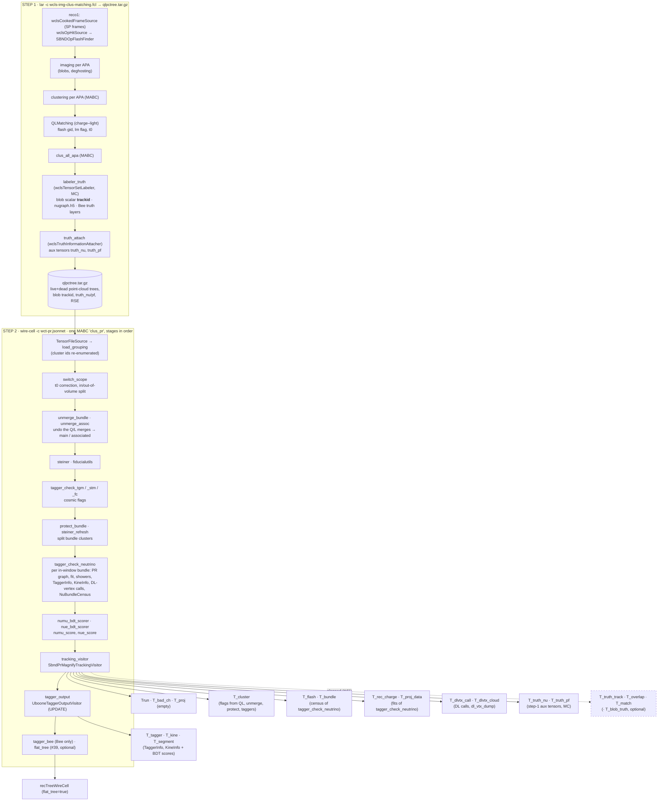
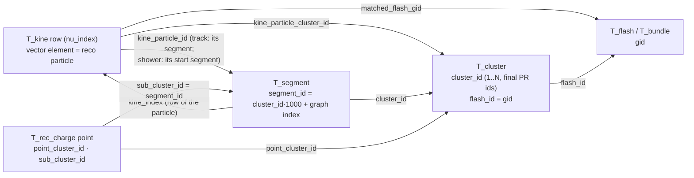

# 41 — SBND reco–truth matching at blob, cluster and particle level, in tracking-pr.root and the merged CAF

**Status: plan, for discussion with Haiwang. Nothing is implemented yet.**

The goal is a reco→truth match, and a truth→reco match, for SBND MC. It lives in `tracking-pr.root` (and so in the flat CAF's `recTreeWireCell`) and is computed inside the Wire-Cell chain. A user can then reproduce Matteo Vicenzi's bee-based matching from the ROOT file alone, and choose their own quality cuts without rerunning the chain.

Builds on #39 and #40 (the CAF merge), #35 (`T_dlvtx_*` with SCE-shifted truth vertices) and the larwirecell `TensorSetLabeler` (blob truth labels).

## 0. The request (Haiwang, 2026-10-12)

1. Understand the current `tracking-pr.root`:
   - every tree, and at which PR stage it is produced (a Mermaid diagram);
   - in particular, `T_kine.kine_particle_*` and how it relates to `T_cluster`.
2. Read Matteo's matching (`/exp/sbnd/app/users/mvicenzi/sbnd-wirecell/work/truthmatch.py`, which works from Bee plus `tracking-pr.root`). Work out what is needed to reach the same criteria from `tracking-pr.root` alone.
3. Add blob→truth-particle matching in step 1 (img-clus-match) and aggregate it to reco cluster→truth and particle→truth. Reco inefficiency and ghosts must be handled the way Matteo handles them. The goal is to reproduce his results, or come close.

Requirements:
- **Validation:** the other trees are unchanged, and Matteo's algorithm run on the new trees gives his bee-based result, identical or close.
- **Truth labeling:** use deposits plus the full pseudo-simulation (SCE, drift, diffusion, readout window).
- **Flexibility:** keep enough information that users can judge match quality and cut on it.
- **Size:** do not store the full set of Bee points.

## 1. The current tracking-pr.root

Example: `production-prep/r7-r26-master-b7bd2a1a/mc-cv/f0000/pr/pr_evt2/tracking-pr.root`.
- Code: toolkit `sbnd-wc-flatcaf` `f6fd2209`.
- Joins measured on 1,212 mc-cv, 48 nueCC and 200 beam-on r7 events.

### 1.1 Where each tree comes from

### 1.2 The trees

`STV` = `root/src/SbndPrMagnifyTrackingVisitor.cxx`, `UTO` = `root/src/UbooneTaggerOutputVisitor.cxx`.

| tree | one entry is | data comes from (stage) | writer | MC/data | when |
|---|---|---|---|---|---|
| `Trun` | the event | config, census counters, provenance strings | STV `write_trun` | both | always |
| `T_bad_ch` | a dead-channel range (`chid`, `plane`, `start/end_time`) | step-1 dead grouping | STV `write_bad_channels` | both | always |
| `T_proj` | one empty entry, 0 branches | — (kept for old readers) | STV | both | always |
| `T_cluster` | **one PR cluster** (every live cluster, in-scope or not) | ids final after `protect_bundle`. Flags from QL (`lm`, `matched_flash_gid`), unmerge/protect (`is_main`, `is_associated`), `switch_scope` (`in_scope`, `cluster_t0_us`), taggers (`tgm`/`stm`/`fc`) | STV `write_cluster_summary` | both | always |
| `T_flash` | one optical flash (`gid`, `tpc`, `time_us`, `pe`, `in_window`, `n_matched_*`) | census of `tagger_check_neutrino` | STV | both | always |
| `T_bundle` | one in-window flash bundle (`gid`, `reason`, `nu_index`, `sel/final_cluster_id`, `n_*`) | census of `tagger_check_neutrino` | STV `write_nu_census` | both | bundles exist |
| `T_rec_charge` | **one fitted 3D point** of a candidate's PR graph (segment points and vertices) | `tagger_check_neutrino` fits, all candidates | STV `write_t_rec_data` | both | candidate (else 0 rows) |
| `T_proj_data` | one row; vectors per fitted cluster: 2D (channel, tick) charge, error, prediction | `tagger_check_neutrino` fits | STV `write_proj_data` | both | always (empty without a fit) |
| `T_dlvtx_call` | one DL-vertex network call (trad / rerank / dl / final vertex, decision, MC truth vertex SCE-shifted) | `tagger_check_neutrino` | STV `write_dlvtx` | both | `dl_vtx_dump=true` |
| `T_dlvtx_cloud` | one point of a call's network input | same | same | both | same |
| `T_truth_nu` | one true neutrino interaction (`nu_idx` 0-based, `pdg`, `ccnc`, `mode`, `E`, `vtx_*`, `t`, `edep`) | step-1 `truth_attach` → aux tensor | STV `write_truth` | MC | always on MC |
| `T_truth_pf` | one G4 particle from a beam neutrino with KE > 10 MeV (`trackid`, `parent/mother_trackid`, `pdg`, `E`, `KE`, start/end, `nu_row`) | same | same | MC | same |
| `T_tagger` | **one candidate** (`nu_index`): 1,246 tagger features, `numu/nue_score`, `act_*` roster | `TaggerInfo` + BDT scorers | UTO | both | candidate only |
| `T_kine` | **one candidate**: Enu, π0, excluded energy, and **one vector element per reco particle** | `KineInfo` (`fill_kine_tree`) | UTO | both | candidate only |
| `T_segment` | one segment of a candidate's PR graph (`segment_id`, `cluster_id`, `shower_id`, `in_enu`, `kine_index`, `pdg`, `length_cm`, `ke_mev`) | candidate graph + `KineInfo` links | UTO `fill_links` | both | candidate only |

MC has 12 trees without a candidate and 15 with one. Data has 10 and 13.

### 1.3 Ids, and `T_kine.kine_particle_*` vs `T_cluster`

- **Cluster ids** are re-numbered 1..N after every stage, so `T_cluster.cluster_id` are the final PR clusters, after `switch_scope`, both unmerges and `protect_bundle`. They are **not** the step-1 ids, and no tree maps them to step 1 or to blobs. No stage after `steiner_refresh` changes clusters, so ids stored by `tagger_check_neutrino` equal the writers' ids.
- **One `kine_particle_*` element is one reco particle:** either one track segment or one whole shower. In mc-cv: 1,311 track rows, 4,174 shower rows.

  | branch | meaning |
  |---|---|
  | `kine_energy_particle` | kinetic energy, MeV |
  | `kine_energy_info` | how it was measured: 0 dQ/dx, 1 range, 2 charge |
  | `kine_particle_type` | PDG |
  | `kine_energy_included` | the walk's flag (1, or 3 for a connection-type-3 shower). Every row is summed into `kine_reco_Enu` regardless |
  | `kine_particle_id` | `cluster_id·1000 + segment index` of the track, or of the shower's start segment |
  | `kine_particle_is_shower` | 1 for a shower |
  | `kine_particle_cluster_id` | the PR cluster of that (start) segment, a `T_cluster.cluster_id` |
  | `kine_particle_nseg` | 1 for a track, the number of member segments for a shower |
  | `kine_particle_pool` | which pass added it: 0 main-vertex edge, 1 BFS, 2 leftover shower, 3 orphan, 4 guard-freed, 5 near cross-cluster |

- **Measured joins:**
  - `kine_particle_cluster_id` ∈ `T_cluster` (100 %), and equals `kine_particle_id // 1000` (100 %).
  - (`nu_index`, `kine_particle_id`) ∈ `T_segment.segment_id` and ∈ `T_rec_charge.sub_cluster_id` (100 %).
- **A candidate spans several clusters:** only 1,393 of 4,560 mc-cv particles sit on the main cluster (`T_kine.cluster_id`); the rest are on the bundle's companion clusters.
- **`T_rec_charge` ids:**
  - `cluster_id` is the candidate's main cluster, the same on every row.
  - `point_cluster_id` is the point's own PR cluster.
  - `real_cluster_id` and `sub_cluster_id` are the same value, the `segment_id` (−1 on vertex rows).
  - `particle_id` is the segment PDG.
  - (`tracking-pr_trees.md` in Matteo's repo calls the `//1000` value an "origin cluster of a merged object". It is the point's own PR cluster.)

### 1.4 Truth already in the chain

| what | where | reaches tracking-pr.root? |
|---|---|---|
| one dominant G4 `trackid` per **blob** | step-1 `labeler_truth`, blob `scalar` PC, **inside `qlpctree.tar.gz`** (r7 mc-cv f0000: 87.9 % of blobs, 98.1 % of blob charge labeled) | no; nothing in `clus/` or `root/` reads it |
| `truth_nu`, `truth_pf` | step-1 `truth_attach` → aux tensors | yes: `T_truth_nu`, `T_truth_pf` |
| `truth_per_track` (labeler) | in the tar | no (not in `aux_datatypes`) |
| SCE-shifted true vertex | `T_dlvtx_call.truth_*` | yes, for candidates with a DL call |

The labeler's **pseudo-simulation**, configured in `wcls-img-clus-matching-pr-lib.jsonnet:429-453`, `TensorSetLabeler.cxx:843-1208`:
- **Input:** `ionandscint:priorSCE` deposits.
- **SCE:** shifted true→reco with the TrueFwd map.
- **Drift:** using each deposit's own G4 time, so out-of-time cosmics land correctly.
- **Smearing:** longitudinal and transverse diffusion (`sqrt(2Dt)`) plus SP filter smearing.
- **Matching:** a deposit counts for a blob within (1 wire, 2 ticks) + 3σ of the blob's wire and tick bounds.
- **Label:** the blob gets the trackid with the most electrons. `abs(TrackID)` folds unsaved descendants into their saved ancestor.
- **Readout window:** applied only to the `sed-*` Bee layers, not to blob labeling.
- **Stored per blob:** only `trackid`, no purity.

## 2. Matteo's matching (Step 2 of the request)

Code: `work/truthmatch.py` (195 lines) and `work/wcreco.py`. Docs: `docs/point_labelling.md`, `docs/matching_and_efficiency.md`, and his own proposal `docs/toolkit_truth_match_plan.md`. Results on our r7: `work/out/r7/{bnb,nuecc}/reco_candidates_*.csv` (bnb: 6,130 candidates, 6,077 matched).

### 2.1 The algorithm (SPINE's `MatchProcessor` rule)

| element | definition | source today |
|---|---|---|
| points | every **imaging point** of every cluster (in-scope or not); q = mean wire charge over live planes (`MultiAlgBlobClustering.cxx:3291`) | Bee `img-global` (step 1) |
| point truth | the point's **blob** label: G4 track, or none (= ghost or labeler miss) | Bee `truth_trackid_labeled` / `truth_unlabeled`, joined on rounded (x, y, z) |
| track → neutrino | `nu_idx`: k ≥ 1 neutrino k, 0 not from a beam neutrino | Bee `sed-smear_readout` |
| point → PR cluster, → segment | joined on (y, z, q), then on PR (x, y, z) | Bee `clustering-pr-global`, `shower_track-global` (step 2) |
| truth objects | one per neutrino (`nu<k>`), one per non-beam G4 track (`cosmic<trackid>`) | — |
| reco objects | `cand<i>` = points of the segments in candidate i's **particle-flow tree** (the Bee `mc.json` `nu K` subtree, minus pseudo-particles); `pr<c>` = the rest of PR cluster c; `img<c>` = an imaging cluster with no PR counterpart | Bee `mc.json` + `T_rec_charge` |
| overlap | IoU = \|r∩t\| / (\|r\|+\|t\|−\|r∩t\|) in points (or charge). **\|r\| includes unlabeled points**, so ghosts lower a reco object's IoU; \|t\| counts only that truth object's labeled reco points | — |
| match | each reco object's best truth and each truth object's best reco, independently, above `min_overlap` (0); `mutual` where they agree | — |

**How imperfection is handled:**
- **Ghosts:** unlabeled points are counted in \|r\|.
- **Reco inefficiency:** truth deposits that made no blob are simply absent from \|t\|. This is SPINE's choice, since the truth is "adapted" onto reco points.
- **Splitting:** truth→reco takes the best object and reports its IoU.
- **Merging:** reco→truth takes the best truth and reports its IoU.
- **Cuts:** none in the loop; IoU, shared counts and `mutual` are written per row.

### 2.2 What `tracking-pr.root` would need, against what exists

| needed | in memory at `tracking_visitor`? | in the file today? |
|---|---|---|
| per imaging point: its blob's trackid | yes: `cluster->children()` blobs carry `trackid`; `blob_with_point(i)` | no |
| per imaging point: its PR cluster | yes (the grouping) | no (only counts in `T_cluster.npoints`) |
| per imaging point: its segment | yes: `seg->global_indices("associate_points")` per candidate graph (what the Bee `shower_track` layer dumps) | no (`T_rec_charge` is the fit cloud, a different point set) |
| the candidate's particle-flow segment set | yes (the same code builds the Bee `mc.json` tree) | partly (`T_segment.in_enu` is the `T_kine` set; the PF tree applies different gates) |
| trackid → `nu_idx` for every labeled track | **no**. `T_truth_pf` holds only beam-ν particles with KE > 10 MeV; on r7, 9.5 % of ν-labeled blobs carry a lower-KE trackid. The labeler's ν-trackid set is not serialized | no |
| Michel electron merged into its muon | no. The **Bee label is Michel-merged; the blob scalar is not** | no |

**What blocks reproducing Matteo's result from ROOT alone:**
1. the trackid → `nu_idx` map, which needs the step-1 labeler;
2. the per-point reco and truth labels, which can be aggregated in step 2 (no per-point storage needed);
3. the PF-tree candidate definition, which can be flagged in step 2;
4. the Michel merge convention, available if the labeler exports it.

## 3. Design (Step 3)

### 3.1 Step 1, the larwirecell labeler (`wclsTensorSetLabeler`, MC only)

Nothing changes in the reco: the labeler runs after `clus_all_apa`. What's added is extra arrays written to the blob `scalar` PC and one aux tensor.

**Per blob, next to `trackid`:**

| scalar | meaning | why |
|---|---|---|
| `trackid` | dominant G4 track (unchanged) | |
| `truth_q` | electrons of all deposits accepted for this blob (after SCE, drift, diffusion, SP smearing, 3σ) | blob completeness and ghost tests |
| `truth_q_dom` | electrons of the dominant track | **purity** = `truth_q_dom/truth_q`, for quality cuts |
| `trackid2`, `truth_q2` | the second track | blobs shared by two particles (e.g. at a vertex) |

**One per-event aux tensor `truth_track`**, one row per G4 track that deposited inside the readout window:

| column | meaning |
|---|---|
| `trackid` | as on blobs (`abs(TrackID)`) |
| `nu_idx` | 0-based `T_truth_nu.nu_idx`; −1 if not from a beam neutrino. **Fills the gap of `T_truth_pf`** |
| `bee_trackid` | the Michel-merged id the Bee layers use (Matteo's convention) |
| `ancestor_trackid` | the primary, for SPINE-style grouping of a cosmic's secondaries |
| `pdg`, `mother_trackid` | from MCParticle |
| `q_readout` | electrons inside the readout window after the full pseudo-sim: the truth-side size in charge, for completeness |
| `q_in_blobs` | the part of `q_readout` accepted by some blob |

Both reach step 2 by adding `truth_track` to `aux_datatypes`, the path `truth_nu` and `truth_pf` already use.

**Readout window:** apply the `sed-*` readout window to `q_readout` (blob labeling is already bounded by the blobs' own ticks).

### 3.2 Step 2, the toolkit matcher (MC only, a knob, default off)

- **Pure computation**, no ROOT: `clus/inc/WireCellClus/TruthMatch.h`, with doctests. It:
  - accumulates the overlaps;
  - builds the reco and truth objects;
  - computes IoU and the SPINE argmax in both directions.
- **Gathering:** `SbndPrMagnifyTrackingVisitor` (knob `save_truth_match`, jsonnet TLA `truth_match`). Nothing is written when no blob carries `trackid` (data). It walks:
  - every cluster;
  - its default-scope points;
  - `blob_with_point` → the blob's labels;
  - `associate_points` of every candidate graph → segment;
  - segment → `T_kine` particle (`KineSegmentLinks`) and PF-tree membership.
  - The point weight is the same q as the Bee `img-global` point.

**New trees.** All are small and flat, and nothing per point:

| tree | one entry is | columns | size |
|---|---|---|---|
| `T_truth_track` | one truth track (from `truth_track`) | as in 3.1 + `n_points`, `q_points` (its labeled reco points) | ~10²/event |
| `T_overlap` | one (reco piece × trackid) pair, the **sufficient statistics** | piece = (`nu_index`, `cluster_id`, `segment_id`, `kine_index`, `in_pf_tree`); `trackid` (−1 = unlabeled); `n_points`, `q`, and quality-split sums `n_points_pure`/`q_pure` (blobs with purity ≥ 0.5) | ~10²–10³/event |
| `T_match` | one reco or truth object at one level | `level` (cluster / particle / candidate), `direction`, `object_id`, `size_n`, `size_q`, `n_unlabeled`, top-3 partners (`match_id[3]`, `iou_n[3]`, `iou_q[3]`, `n_shared[3]`), `mutual` | ~10²/event |
| `T_blob_truth` (**optional**, knob, default off) | one blob | `cluster_id`, `npoints`, `q`, `trackid`, `purity`, `trackid2` | ~4×10³/event, ~+10 % file |

**The three levels in `T_match`:**
- **cluster:** reco object = a `T_cluster` row.
- **particle:** reco object = a `T_kine` vector element; a shower is the union of its segments.
- **candidate:** reco object = Matteo's: the PF-tree segments of `nu_index` i, with the remainder per cluster.

For truth objects, `nu_idx` groups a neutrino's tracks; non-beam tracks are grouped by `bee_trackid` (default, as Matteo) or by `ancestor_trackid`, written both ways.

**Flexibility without rerunning:** from `T_overlap` plus `T_truth_track` a user can recompute every IoU with different choices:
- a different object definition (`in_enu` instead of the PF tree, whole clusters);
- charge instead of points;
- pure blobs only;
- truth grouping by ancestor;
- completeness against `q_readout` (reco inefficiency).

`T_match` stores the default answer, so most users need nothing else.

### 3.3 The merged CAF

`RootFlatTreeVisitor` (#39) flattens every tree of `tracking-pr.root`, so the new trees reach `recTreeWireCell` without code changes. The fixed schema (`aurora/schema/recTreeWireCell.schema.json`) must be regenerated with `make-schema.py` (#39 gate G5). That gives a new md5, which `merge-caf.py` checks.

## 4. Validation

| # | check | how | pass |
|---|---|---|---|
| V1 | the reco is untouched | rerun step 1 + step 2 on r7 MC units (mc-cv f0000–f0019, nueCC f0000–f0009, ~300 events) with the new labeler and `truth_match=true`; compare every value of every old tree with r7, and the old arrays of `qlpctree.tar.gz` | identical (by content, not bytes) |
| V2 | data unaffected | the same on 2 beam-on units | identical, no new trees |
| V3 | labels consistent with Bee | per event: labeled + unlabeled point counts in `T_overlap` = `truth_trackid_labeled` / `truth_unlabeled` of the new step-1 zip; each segment's `n_points` = its `shower_track-global` count; every labeled trackid in `T_truth_track` | exact |
| V4 | **Matteo from ROOT alone** | a reader (ai-helper `scripts/`) builds Matteo's point frame from `T_overlap` and calls his `truthmatch` functions unchanged; compare per candidate with `work/out/r7/bnb` and `nuecc` (`ct_match`, `ct_iou`, `ct_n`, `ct_n_unlabeled`, `ct_n_shared`, `ct_mutual`, `nu_ct_*`) | identical, except where his Bee joins report problems (each listed with its reason) |
| V5 | `T_match` = V4 | the toolkit's own result vs the Python result on the same file | identical |
| V6 | merged CAF | `run-pairs.sh` on 2 MC pairs with the new schema; `validate-merge.py` PASS | PASS |
| V7 | cost | added time and file size in step 1 and step 2 | < 2 % time, file size reported |

## 5. Phases

1. **Labeler** (larwirecell, new branch from `sbnd-wc-flatcaf`):
   - the per-blob scalars and the `truth_track` tensor;
   - build and deploy to `opt` (with a backup);
   - check V3 on 1 unit.
2. **Toolkit** (new branch from `sbnd-wc-flatcaf`):
   - `TruthMatch.h` + doctests;
   - the visitor knob and trees;
   - the jsonnet TLA;
   - `aux_datatypes` += `truth_track`;
   - the step-2 cfg-proof: with the knob off, the compiled config is byte-identical.
3. **Python reader + comparison** (ai-helper `issues/41-*/scripts/`): V4, V5.
4. **Validation run** V1–V3 and V6 on ~300 MC and 2 data units, at ≤ 50 % of sbndbuild03.
5. **CAF:** schema regenerated, `aurora/` README and AGENTS updated, doc finished.

## 6. Questions and limits

**Decisions for Haiwang:**
1. **Step 1 must change, so validation reruns step 1.** The `nu_idx` of every labeled track, the Michel merge and the purity exist only in the labeler. A step-2-only version on the existing r7 tars is possible, but its `nu_idx` would be wrong for the ~10 % of neutrino-labeled blobs whose track is below 10 MeV (they would look like cosmics). Proposal: change step 1.
2. **Candidate definition** for the default `T_match` candidate level: Matteo's PF tree (reproduces him), or `T_kine`'s set (`in_enu`). Proposal: the PF tree as the default, with both flags in `T_overlap`.
3. **Cosmic truth grouping** default: per Michel-merged track (Matteo), or per ancestor (SPINE). Proposal: Matteo's as the default, both stored.
4. **`T_blob_truth`:** off by default (≈ +10 % file size)?
5. **Pushes:** may I push the new larwirecell and toolkit branches to your forks (as for #39)?

**Limits, and what cannot be exact:**
- **Matteo's Bee joins are lossy** (rounded coordinates, duplicate keys popped in order); his `point_truth` problem counters record it. The new trees join by object identity, so they can only agree where his joins succeeded. Every difference will be listed against his counters.
- **Reco inefficiency cannot enter a point IoU.** A deposit that made no blob has no reco point. As in SPINE, \|t\| counts labeled reco points. `q_readout` and `q_in_blobs` give the truth-side completeness that point IoU cannot.
- **A blob carries one dominant label**, as today. Points of a blob shared by two particles all go to the dominant one; `trackid2` and purity expose it, but the IoU stays blob-granular.
- **Data:** no truth, no new trees.

## Log
- 2026-10-12: issue opened. Current `tracking-pr.root` mapped (stages, trees, ids; joins measured on 1,460 r7 events). Matteo's matching and his toolkit proposal read. Blob `trackid` found already inside `qlpctree.tar.gz`. Plan written, waiting for discussion.
