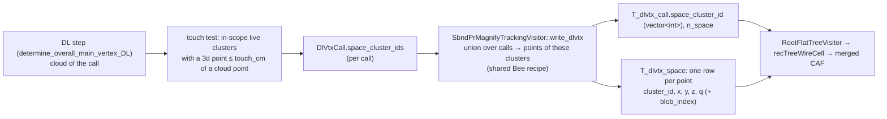

# Issue 44: DL vertex with Bee space points — candidate-only sampled points in `tracking-pr.root` and the merged CAF, and a space-point inference path

GitHub: https://github.com/HaiwangYu/wire-cell-toolkit-ai-helper/issues/44

**Status (2026-11-04): plan only.** Nothing is implemented. Implementation and tests are to be done on Aurora. The only work so far is read-only surveys and two measurement scripts run on Polaris (`scripts/`).

Builds on:
- #35: the DL dump `T_dlvtx_call` / `T_dlvtx_cloud`.
- #39: the flat CAF merge, `recTreeWireCell`.
- #41: the truth match. Its gatherer already walks every cluster's points with the Bee charge recipe.
- #42: the r8 production pin.
- #43: the PR #543 (DV2-MAX, `r7_cloud`) review.
- WireCell PR #543: https://github.com/WireCell/wire-cell-toolkit/pull/543. This is the non-Bee version, which takes the trajectory-fit cloud only.

## 0. The request (Haiwang, 2026-11-04)

- Sne's study shows that DL vertexing with sampled Bee points does better. Add equivalent sampled points to `tracking-pr.root` and to the merged CAF.
- Study how Sne used the Bee points.
- Suggest how to add the equivalent points, and how to change the inference workflow. Today all inference uses the trajectory-fit cloud.
- Add only the points of the clusters/blobs related to the neutrino candidate, so that disk and memory do not grow much.
- Plan only. Implementation and tests will be done on Aurora.

## 1. How Sne used the Bee points (survey of `/lus/eagle/projects/neutrinoGPU/snehadri`, 2026-11-04)

**The two arms.** Both are DV2-MAX with the same network, features, ranker and training scheme (5-fold nested cross-fit, r7). Only the input point set differs.

| arm | input points | source |
|---|---|---|
| `r7_cloud` (PR #543's bundle) | `T_dlvtx_cloud`: PR-graph vertex rows plus trajectory-fit points of one candidate | `tracking-pr.root` |
| **`r7_space`** | the same cloud **plus** the Bee points of every imaging cluster that **touches** the cloud | the cloud, plus step-2 Bee `pr/mabc-pr.zip`, layer `clustering-pr-global` |

**Which Bee points** (`sbnd-vertexer/r7/export_r7_space.py`):
- **Layer.** The step-2 (PR-stage MABC) layer `clustering-pr-global`:
  - `pcname: '3d'`, the BlobSampler points of each blob;
  - coordinates `common_corr_coords(pos_offset_on)`, which is `x_t0cor, y, z` on MC: T0-corrected, not SCE-corrected;
  - `filter: 1`, in-scope clusters only;
  - `q` = the mean of the U/V/W wire charges over the non-dead planes (`MultiAlgBlobClustering::fill_bee_points_from_cluster`).
- **Fields used.** `x, y, z, q, cluster_id`. `real_cluster_id` is not used.
- **Selection.** Every point of every Bee cluster with **any point within 1 cm of any cloud point** of the call (`TOUCH_CM = 1.0`, `cKDTree`):
  - whole clusters;
  - no crop radius, no charge cut, no down-sampling.
- **Frame.** Cloud and Bee share one frame (median signed dx 0.000 cm on 314 nueCC events). The cache builder applies the same 0.31 cm x-shift to both.
- **Charge.** Bee `q` is used as written. The cloud dQ is rescaled by one constant, `Q_RATIO = median(space q) / median(cloud dQ) = 0.2408` (`cache/r7_space/cache_info.json`).
- **Cluster ids.** Bee ids, renumbered by size. A cloud point takes the id of its nearest Bee point within 1 cm; otherwise it is grouped by 3 cm connected components.
- **The model input** is one concatenated set, Bee points then cloud (`prep_r7_space_cache.py`: `points_xyz = concatenate([S, C])`). There is no Bee/cloud flag.
- **Ranker candidates are unchanged.** They are the PR-graph vertex rows (`cand`), the traditional vertex (`tag`), the cluster ends, the CNN modes, and the imaging points near the anchors. In `r7_space`, those imaging points include Bee points.

**Results** (`r7/results/compare_r7_arms.md`). 12,693 r7 events, production cloud, held-out predictions, paired by event:

| fraction < 1 cm | all | νe CC | νμ CC |
|---|---|---|---|
| `r7_space` | **0.930** | 0.942 | 0.945 |
| `r7_cloud` | 0.864 | 0.866 | 0.892 |
| production final vertex | 0.627 | 0.604 | 0.698 |

- The difference is +0.066 [0.060, 0.072] (McNemar p = 1.8e-114).
- The median distance falls from 0.265 cm to 0.175 cm.
- The fraction < 0.5 cm rises from 0.732 to 0.877.
- **The gain comes from events where the cloud misses the vertex** (νe CC, binned by the distance from the true vertex to the nearest cloud point):

  | nearest cloud point | events | `r7_space` | `r7_cloud` |
  |---|---|---|---|
  | 0–1 cm | 7,003 | 0.950 | 0.921 |
  | 1–2 cm | 530 | 0.892 | 0.477 |
  | 2–5 cm | 240 | 0.821 | 0.100 |

  The selected Bee points come within 1 cm of the true vertex in 100 % of the calls; the cloud does in 88 %.

**Caveats Sne recorded:**
1. **Placement can erase the gain** (`r7/results/snap_loss.md`):

   | placement | `r7_space` | `r7_cloud` |
   |---|---|---|
   | raw pick | 0.930 | 0.864 |
   | nearest cloud point | 0.852 | 0.828 |
   | snapped to the nearest PR-graph vertex | 0.740 | 0.735 |

   The `r7_space` picks sit further from the graph (median 0.41 cm vs 0.33 cm). So the in-chain placement (`dv2_split_move`, which moves the vertex onto the pick) decides whether the gain survives. It must be measured on the **final** vertex, not on the raw pick.
2. **Offline only.** There is no `r7_space` bundle. PR #543 ships only `r7_cloud`.
3. **No Bee for the bulk sample.** fg1 (~600k events) kept no Bee files, so `r7_space` could not train on it.
4. **Hold-out contamination.** Every r7-trained model saw most of Xin's hold-out events, so the evaluation must use files outside r7 (as #43 did).
5. **538 far misses (> 5 cm).** In 417 of them the right spot was proposed but ranked lower, so they are ranking errors.

## 2. What the chain has today (toolkit `sbnd-wc-flatcaf` `d06a47d7`, PR #543 `feb3ddeb`)

- **The step-1 tar already carries the Bee source.** `qlpctree.tar.gz` holds the live clusters with their blob-sampled `3d` points and per-plane charge. Step 2 rebuilds the same clusters, and its MABC writes `clustering-pr-global` from them. **No step-1 change is needed.**
- **Timing.** The `clustering-pr` layer is filled after the whole PR pipeline (`MultiAlgBlobClustering.cxx:4268-4278`). The DL step runs earlier, inside `tagger_check_neutrino`. No stage after `steiner_refresh` changes cluster membership (#41 §1.3), so the two should agree. G3 below checks this.
- **The DL cloud** (`NeutrinoVertexFinder.cxx:4741-4810`, PR #543) contains every PR-graph vertex, then every segment's interior fit points, of the candidate's `main_cluster` + `other_clusters`. It is recorded per call in `T_dlvtx_call` / `T_dlvtx_cloud` (`dl_vtx_dump`, on in production).
- **The point recipe exists twice.** One copy is the Bee writer (`fill_bee_points_from_cluster`, default branch). The other is the #41 truth-match gatherer (`SbndPrTruthMatch.cxx`, "the point weight is the same q as the Bee `img-global` point").
- **The merged CAF.** `RootFlatTreeVisitor` (#39) flattens every tree, so a new tree reaches `recTreeWireCell` without code. The fixed schema (`aurora/schema/recTreeWireCell.schema.json`) must be regenerated (gate G5 of #39), which gives a new md5.
- **r8 semi-production keeps no Bee** (#42). So Bee zips are not a production data product, and Sne's zip-based export cannot scale.

## 3. Size, measured (Polaris, 2026-11-04, `scripts/space_size.py`)

Sne's r7 copy (`snehadri/dlvtx/r7-r26-master-b7bd2a1a`, step 2 with `dl_vtx_dump`). The method:
- for 25 units per sample, apply Sne's rule (clusters touching any call's cloud within 1 cm);
- take the union over the calls of the event;
- write the points as a flat ROOT tree (`x, y, z, q` float32, `cluster_id` int32) with uproot.

| | MC nueCC (246 events, 468 calls) | MC CV (355 events, 384 calls) |
|---|---|---|
| Bee points per call: median / mean / p90 | 4,046 / 5,328 / 11,138 | 1,692 / 2,847 / 6,255 |
| cloud points per call: median | 434 | 274 |
| whole-event Bee points: median | 30,451 | 25,842 |
| touched clusters per event: median | 28 | 8 |
| sum over calls / union per event | **2.00** | **2.00** |
| new tree, zlib-1, full float32 precision | **11.3 B/point, 57.5 kB/event** | **11.4 B/point, 17.6 kB/event** |
| the same, LZMA-6 | 8.4 B/point, 42.6 kB/event | 8.6 B/point, 13.2 kB/event |
| the same, rounded as Bee JSON (6 significant digits), zlib-1 | 6.4 B/point, 32.5 kB/event | 6.7 B/point, 10.2 kB/event |
| `tracking-pr.root` (r7, without the #41 trees) | 355 kB/event | 197 kB/event |

Notes:
- Per-event figures are averaged over all events, including those without a DL call (95 % of nueCC events have one, 54 % of CV events).
- "Full precision" adds sub-JSON noise to emulate float32 written in-chain. The JSON keeps 6 significant digits (`x` to 1e-4 cm, `q` to 0.01).
- **The two passes of the original chain touch the same clusters** (ratio exactly 2.00). So the points belong once per event, keyed by cluster, not per call.
- Candidate-only is **6–14 % of the whole-event Bee points**.
- Expected growth:
  - `tracking-pr.root`: **+9 % (CV) to +16 % (nueCC)**, before the #41 trees and the duplicate `recTreeWireCell` copy;
  - merged CAF: about +2–8 % (the CAF is about 680 kB/event for `recTree` plus about 100 kB/event for `recTreeWireCell`, #41 V7).
- Memory in step 2 is negligible: about 5k points × 20 B per candidate.

An earlier 1-step output on Polaris (NCpi0-19 data, `scripts/bee_cand_count.py`) gave about 6.7k points (mean) on the candidate's clusters against about 730 fit points. That is consistent, but it is an older schema and is not used further.

## 4. Proposal A: the data product — candidate-only Bee points in `tracking-pr.root` and the CAF

**Goal:** exactly the points Sne's `export_r7_space.py` takes from `mabc-pr.zip`, written in-chain with no Bee zip, for the touched clusters only.

### 4.1 What changes

| where | change |
|---|---|
| a shared helper (new, `clus/`) | `bee_points_of_cluster(cluster, scope_coords, filter) → {x, y, z, q, blob_index}`, factored out of `fill_bee_points_from_cluster`'s default branch (scoped view per blob, `get_closest_point_index`, mean live-plane `charge_value`). The Bee writer calls it, so Bee is byte-identical by construction; #41's gatherer can switch to it later. |
| `NeutrinoVertexFinder::determine_overall_main_vertex_DL` | with `dl_vtx_dump_space` on, after `vec_xyzq` is built: run the touch test over the in-scope live clusters of the grouping (the same filter as the Bee set), not just `main_cluster` + `other_clusters`, because Sne's whole-event rule also catches touching non-bundle clusters. Record the touched cluster ids in `DlVtxCall::space_cluster_ids`. Cost: about 10² clusters × about 400 cloud points nearest-neighbour queries per call. |
| `SbndPrMagnifyTrackingVisitor::write_dlvtx` | the union of `space_cluster_ids` over the event's calls → the helper per cluster → `T_dlvtx_space`. `T_dlvtx_call` gains `space_cluster_id` (vector&lt;int&gt;) and `n_space`. |
| cfg | a `pr()` knob `dl_vtx_dump_space` (default false; key omitted when off), plus `space_touch_cm` (1.0) and `space_coords` (= the PR MABC's Bee `clustering` coords); a `wct-pr.jsonnet` TLA |
| workflow `aurora/` | `step2.sh` turns it on with `dl_vtx_dump`; schema regenerated (`make-schema.py`, new md5); README/AGENTS |

**`T_dlvtx_space`** (one row per point of a touched cluster, once per event):

| branch | type | meaning |
|---|---|---|
| `runNo, subRunNo, eventNo` | Int_t | as the other `T_dlvtx_*` |
| `cluster_id` | Int_t | final PR cluster id = `T_cluster.cluster_id` = Bee `cluster_id` |
| `blob_index` | Int_t | the blob within the cluster (the scoped-view index). Joins `T_blob_truth` when that is on, and allows blob-level cuts later |
| `x, y, z` | Float_t | cm, the Bee frame (`x_t0cor, y, z` on MC; plus the position offsets on data) |
| `q` | Float_t | mean live-plane wire charge, as Bee |

Rows are sorted by `cluster_id`, in Bee order within a cluster.

A per-call point set is `T_dlvtx_space[cluster_id ∈ T_dlvtx_call.space_cluster_id]`. This avoids the 2× duplication of the two passes, and of any repeated candidate.

### 4.2 Options inside A (decisions, §8)

- **Selection granularity:**
  - (a) **whole touching clusters**, Sne's rule: recommended, because it is what `r7_space` was trained and measured on;
  - (b) only blobs within R cm of the cloud: smaller, but a new input distribution that needs retraining. `blob_index` keeps (b) possible offline from (a).
- **Precision:** full float32 (simplest; 11 B/point), or rounding to Bee's 6 significant digits (6.5 B/point; bit-identical to what `r7_space` trained on).
- **Per-point truth** (MC): not needed by `r7_space`, whose labels are the vertex only. Available later through `blob_index` → `T_blob_truth`, at no extra cost here.

## 5. Proposal B: the inference workflow

Today in-chain inference is the uboone SCN net (`original`), or with PR #543 DV2-MAX `r7_cloud`, both on the cloud only. Two stages:

### B1. Offline inference from the new trees (no further chain change)

- A reader: `T_dlvtx_call` + `T_dlvtx_cloud` + `T_dlvtx_space` → Sne's `prep_r7_space_cache.build_event` → DV2-MAX `r7_space` → one prediction per call. Output is a friend table keyed by (run, subrun, event, `nu_index`, `call_index`), or a per-CAF friend tree.
- It reads `tracking-pr.root` or the merged CAF (`wc.T_dlvtx_*`).
- **Use:** evaluation and training at production scale. fg1-like bulk samples now carry the points; the zips never did.
- **Limit:** the downstream reco (kinematics, BDT scores, taggers) still uses the in-chain vertex.

### B2. In-chain `r7_space` inference

| where | change |
|---|---|
| bundle | an `r7_space` fold-0 bundle from Sne (as `r7_cloud`); `bundle.json` declares `input: "cloud+space"`, `touch_cm: 1.0`, `q_ratio: 0.2408`, `x_shift_cm: 0.31` |
| Python | `DV2_Vertex` gains optional space arrays (`sx, sy, sz, sq, scluster`), or a second entry point to keep #543's signature stable; `event_from_call_space` vendored from `prep_r7_space_cache.py` (concatenation order, the cloud's q rescaling, the cluster-id rule) |
| C++ (`NeutrinoVertexFinder`) | build the space points with the same helper and the same touch test as A, and pass them. Read the bundle's `input` **at configure**: a mismatch between bundle and knob is a hard error. This is also #543 review item 2 (load and import at configure, fail hard). |
| placement | `dv2_split_move` (move onto the pick). Because of Sne's snap-loss table, also a **distance guard** (#543 review item 1) and an explicit decision on `improve_vertex` (review item 3) |
| cfg | `dv2_bundle = dv2max/r7_space/bundle.json` selects it; `vertex_method` unchanged |

B2 depends on PR #543 and its review fixes; A and B1 do not.

## 6. Validation gates

| gate | check | pass |
|---|---|---|
| G1 | knob off | all compiled SBND configs byte-identical; `tracking-pr.root` and Bee identical (MC-10, NCpi0-19) |
| G2 | knob on is recording-only | every existing tree and Bee layer identical; only `T_dlvtx_space` and the two `T_dlvtx_call` branches are added |
| G3 | **equivalence with Sne's export** | one run with Bee on and the dump on: for every call, the in-chain point set equals `export_r7_space.py`'s selection from the same run's `mabc-pr.zip` (the same clusters; points equal to the JSON's 6 significant digits; same q). MC nueCC + CV ≥ 100 events each, and the two data sets |
| G4 | end-to-end equivalence | Sne's `r7_space` model, fed from the new trees (B1 reader) and from the zips (his code), gives identical predictions per call |
| G5 | CAF | regenerated schema; `run_pair.py` validation PASS on MC and data pairs; size measured |
| G6 | B2 in-chain == standalone | every in-chain call replayed from the dumped cloud + space: identical (as #43 Q2, honouring `trad_valid`) |
| G7 | physics (B2) | the **final** vertex after placement, compared with `original` and `dv2_split_move` + `r7_cloud`. MC from files outside r7/r8 (as #43); selection rates; data nueCC-48 / NCpi0-19 changes |
| G8 | cost | step-2 CPU and RSS with the dump and with B2 (Sne's feature cost is ~38× the cloud's: 0.557 vs 0.0147 s/event); file sizes vs §3 |

## 7. Phases (on Aurora)

| phase | content | depends on |
|---|---|---|
| P0 | decisions (§8); ask Sne for an `r7_space` fold-0 bundle and his reader code | — |
| P1 | A: helper + touch test + writer + knob, on a branch from `sbnd-wc-flatcaf`; doctests; G1, G2 | P0 |
| P2 | G3 + G5 on r8-style validation units (Bee kept), MC + data; size and cost (G8, dump part) | P1 |
| P3 | B1 reader; G4 with Sne's model | P2, Sne's model |
| P4 | B2 on a branch with PR #543 (after its review fixes): hook, bundle, configure check; G6, G7, G8 | P3, #543 |
| P5 | production: `step2.sh` defaults, schema, README/AGENTS; a training-scale MC run with the dump for the next model round | P2 (dump), P4 (in-chain) |

## 8. Questions for Haiwang (proposals in bold)

1. **Selection:** **whole touching clusters, 1 cm** (Sne's rule), or blob-level within R cm?
2. **Precision:** **full float32**, or rounded to Bee's 6 significant digits?
3. **Base for A:** **`sbnd-wc-flatcaf`**, independent of PR #543, so the data product can go into production before the vertexer changes?
4. **Scope of B:** **B1 now, B2 after #543 is fixed and Sne has an `r7_space` bundle**?
5. **Data frame:** Sne's frame check is MC-only. Add a data check (cloud vs Bee coordinates with position offsets on) to G3?
6. **Per-point truth:** not now; `blob_index` keeps it open?

## Log

- 2026-11-04: survey of Sne's `r7_space` (§1); toolkit read (§2); size measurement on Sne's r7 copy (§3); plan (§4–7); issue opened.
