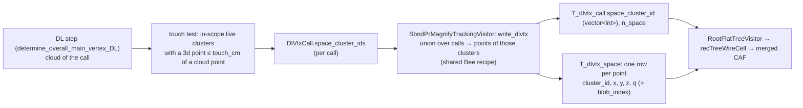

# Issue 44: DL vertex with Bee space points — candidate-only sampled points in `tracking-pr.root` and the merged CAF, and a space-point inference path

GitHub: https://github.com/HaiwangYu/wire-cell-toolkit-ai-helper/issues/44

**Status (2026-11-04): P1 done, P2 done on BNB CV (G1, G2, G3, G5 pass; §10).** The 136-event sample for Sne is on Flare; v2 (`$Y/production-prep/pr544-review/`, §11) has the Bee event merge fixed (PR #544 review). Open items: G3 on nueCC and on data, G8 CPU, then P3 (B1). Implementation and tests are to be done on Aurora. The only work so far is read-only surveys and two measurement scripts run on Polaris (`scripts/`).

Builds on:
- #35: the DL dump `T_dlvtx_call` / `T_dlvtx_cloud`.
- #39: the flat CAF merge, `recTreeWireCell`.
- #41: the truth match. Its gatherer already walks every cluster's points with the Bee charge recipe.
- #42: the r8 production pin.
- #43: the PR #543 (DV2-MAX, `r7_cloud`) review.
- WireCell PR #543: https://github.com/WireCell/wire-cell-toolkit/pull/543. This is the non-Bee version, which takes the trajectory-fit cloud only.

## 0. The request (Haiwang, 2026-11-04)

- Sne's study shows that DL vertexing with sampled Bee points does better. Add equivalent sampled points to `tracking-pr.root` and to the merged CAF.
- Study how Sne used the Bee points.
- Suggest how to add the equivalent points, and how to change the inference workflow. Today all inference uses the trajectory-fit cloud.
- Add only the points of the clusters/blobs related to the neutrino candidate, so that disk and memory do not grow much.
- Plan only. Implementation and tests will be done on Aurora.

## 1. How Sne used the Bee points (survey of `/lus/eagle/projects/neutrinoGPU/snehadri`, 2026-11-04)

**The two arms.** Both are DV2-MAX with the same network, features, ranker and training scheme (5-fold nested cross-fit, r7). Only the input point set differs.

| arm | input points | source |
|---|---|---|
| `r7_cloud` (PR #543's bundle) | `T_dlvtx_cloud`: PR-graph vertex rows plus trajectory-fit points of one candidate | `tracking-pr.root` |
| **`r7_space`** | the same cloud **plus** the Bee points of every imaging cluster that **touches** the cloud | the cloud, plus step-2 Bee `pr/mabc-pr.zip`, layer `clustering-pr-global` |

**Which Bee points** (`sbnd-vertexer/r7/export_r7_space.py`):
- **Layer.** The step-2 (PR-stage MABC) layer `clustering-pr-global`:
  - `pcname: '3d'`, the BlobSampler points of each blob;
  - coordinates `common_corr_coords(pos_offset_on)`, which is `x_t0cor, y, z` on MC: T0-corrected, not SCE-corrected;
  - `filter: 1`, in-scope clusters only;
  - `q` = the mean of the U/V/W wire charges over the non-dead planes (`MultiAlgBlobClustering::fill_bee_points_from_cluster`).
- **Fields used.** `x, y, z, q, cluster_id`. `real_cluster_id` is not used.
- **Selection.** Every point of every Bee cluster with **any point within 1 cm of any cloud point** of the call (`TOUCH_CM = 1.0`, `cKDTree`):
  - whole clusters;
  - no crop radius, no charge cut, no down-sampling.
- **Frame.** Cloud and Bee share one frame (median signed dx 0.000 cm on 314 nueCC events). The cache builder applies the same 0.31 cm x-shift to both.
- **Charge.** Bee `q` is used as written. The cloud dQ is rescaled by one constant, `Q_RATIO = median(space q) / median(cloud dQ) = 0.2408` (`cache/r7_space/cache_info.json`).
- **Cluster ids.** Bee ids, renumbered by size. A cloud point takes the id of its nearest Bee point within 1 cm; otherwise it is grouped by 3 cm connected components.
- **The model input** is one concatenated set, Bee points then cloud (`prep_r7_space_cache.py`: `points_xyz = concatenate([S, C])`). There is no Bee/cloud flag.
- **Ranker candidates are unchanged.** They are the PR-graph vertex rows (`cand`), the traditional vertex (`tag`), the cluster ends, the CNN modes, and the imaging points near the anchors. In `r7_space`, those imaging points include Bee points.

**Results** (`r7/results/compare_r7_arms.md`). 12,693 r7 events, production cloud, held-out predictions, paired by event:

| fraction < 1 cm | all | νe CC | νμ CC |
|---|---|---|---|
| `r7_space` | **0.930** | 0.942 | 0.945 |
| `r7_cloud` | 0.864 | 0.866 | 0.892 |
| production final vertex | 0.627 | 0.604 | 0.698 |

- The difference is +0.066 [0.060, 0.072] (McNemar p = 1.8e-114).
- The median distance falls from 0.265 cm to 0.175 cm.
- The fraction < 0.5 cm rises from 0.732 to 0.877.
- **The gain comes from events where the cloud misses the vertex** (νe CC, binned by the distance from the true vertex to the nearest cloud point):

  | nearest cloud point | events | `r7_space` | `r7_cloud` |
  |---|---|---|---|
  | 0–1 cm | 7,003 | 0.950 | 0.921 |
  | 1–2 cm | 530 | 0.892 | 0.477 |
  | 2–5 cm | 240 | 0.821 | 0.100 |

  The selected Bee points come within 1 cm of the true vertex in 100 % of the calls; the cloud does in 88 %.

**Caveats Sne recorded:**
1. **Placement can erase the gain** (`r7/results/snap_loss.md`):

   | placement | `r7_space` | `r7_cloud` |
   |---|---|---|
   | raw pick | 0.930 | 0.864 |
   | nearest cloud point | 0.852 | 0.828 |
   | snapped to the nearest PR-graph vertex | 0.740 | 0.735 |

   The `r7_space` picks sit further from the graph (median 0.41 cm vs 0.33 cm). So the in-chain placement (`dv2_split_move`, which moves the vertex onto the pick) decides whether the gain survives. It must be measured on the **final** vertex, not on the raw pick.
2. **Offline only.** There is no `r7_space` bundle. PR #543 ships only `r7_cloud`.
3. **No Bee for the bulk sample.** fg1 (~600k events) kept no Bee files, so `r7_space` could not train on it.
4. **Hold-out contamination.** Every r7-trained model saw most of Xin's hold-out events, so the evaluation must use files outside r7 (as #43 did).
5. **538 far misses (> 5 cm).** In 417 of them the right spot was proposed but ranked lower, so they are ranking errors.

## 2. What the chain has today (toolkit `sbnd-wc-flatcaf` `d06a47d7`, PR #543 `feb3ddeb`)

- **The step-1 tar already carries the Bee source.** `qlpctree.tar.gz` holds the live clusters with their blob-sampled `3d` points and per-plane charge. Step 2 rebuilds the same clusters, and its MABC writes `clustering-pr-global` from them. **No step-1 change is needed.**
- **Timing.** The `clustering-pr` layer is filled after the whole PR pipeline (`MultiAlgBlobClustering.cxx:4268-4278`). The DL step runs earlier, inside `tagger_check_neutrino`. No stage after `steiner_refresh` changes cluster membership (#41 §1.3), so the two should agree. G3 below checks this.
- **The DL cloud** (`NeutrinoVertexFinder.cxx:4741-4810`, PR #543) contains every PR-graph vertex, then every segment's interior fit points, of the candidate's `main_cluster` + `other_clusters`. It is recorded per call in `T_dlvtx_call` / `T_dlvtx_cloud` (`dl_vtx_dump`, on in production).
- **The point recipe exists twice.** One copy is the Bee writer (`fill_bee_points_from_cluster`, default branch). The other is the #41 truth-match gatherer (`SbndPrTruthMatch.cxx`, "the point weight is the same q as the Bee `img-global` point").
- **The merged CAF.** `RootFlatTreeVisitor` (#39) flattens every tree, so a new tree reaches `recTreeWireCell` without code. The fixed schema (`aurora/schema/recTreeWireCell.schema.json`) must be regenerated (gate G5 of #39), which gives a new md5.
- **r8 semi-production keeps no Bee** (#42). So Bee zips are not a production data product, and Sne's zip-based export cannot scale.

## 3. Size, measured (Polaris, 2026-11-04, `scripts/space_size.py`)

Sne's r7 copy (`snehadri/dlvtx/r7-r26-master-b7bd2a1a`, step 2 with `dl_vtx_dump`). The method:
- for 25 units per sample, apply Sne's rule (clusters touching any call's cloud within 1 cm);
- take the union over the calls of the event;
- write the points as a flat ROOT tree (`x, y, z, q` float32, `cluster_id` int32) with uproot.

| | MC nueCC (246 events, 468 calls) | MC CV (355 events, 384 calls) |
|---|---|---|
| Bee points per call: median / mean / p90 | 4,046 / 5,328 / 11,138 | 1,692 / 2,847 / 6,255 |
| cloud points per call: median | 434 | 274 |
| whole-event Bee points: median | 30,451 | 25,842 |
| touched clusters per event: median | 28 | 8 |
| sum over calls / union per event | **2.00** | **2.00** |
| new tree, zlib-1, full float32 precision | **11.3 B/point, 57.5 kB/event** | **11.4 B/point, 17.6 kB/event** |
| the same, LZMA-6 | 8.4 B/point, 42.6 kB/event | 8.6 B/point, 13.2 kB/event |
| the same, rounded as Bee JSON (6 significant digits), zlib-1 | 6.4 B/point, 32.5 kB/event | 6.7 B/point, 10.2 kB/event |
| `tracking-pr.root` (r7, without the #41 trees) | 355 kB/event | 197 kB/event |

Notes:
- Per-event figures are averaged over all events, including those without a DL call (95 % of nueCC events have one, 54 % of CV events).
- "Full precision" adds sub-JSON noise to emulate float32 written in-chain. The JSON keeps 6 significant digits (`x` to 1e-4 cm, `q` to 0.01).
- **The two passes of the original chain touch the same clusters** (ratio exactly 2.00). So the points belong once per event, keyed by cluster, not per call.
- Candidate-only is **6–14 % of the whole-event Bee points**.
- Expected growth:
  - `tracking-pr.root`: **+9 % (CV) to +16 % (nueCC)**, before the #41 trees and the duplicate `recTreeWireCell` copy;
  - merged CAF: about +2–8 % (the CAF is about 680 kB/event for `recTree` plus about 100 kB/event for `recTreeWireCell`, #41 V7).
- Memory in step 2 is negligible: about 5k points × 20 B per candidate.

An earlier 1-step output on Polaris (NCpi0-19 data, `scripts/bee_cand_count.py`) gave about 6.7k points (mean) on the candidate's clusters against about 730 fit points. That is consistent, but it is an older schema and is not used further.

## 4. Proposal A: the data product — candidate-only Bee points in `tracking-pr.root` and the CAF

**Goal:** exactly the points Sne's `export_r7_space.py` takes from `mabc-pr.zip`, written in-chain with no Bee zip, for the touched clusters only.

### 4.1 What changes

| where | change |
|---|---|
| a shared helper (new, `clus/`) | `bee_points_of_cluster(cluster, scope_coords, filter) → {x, y, z, q, blob_index}`, factored out of `fill_bee_points_from_cluster`'s default branch (scoped view per blob, `get_closest_point_index`, mean live-plane `charge_value`). The Bee writer calls it, so Bee is byte-identical by construction; #41's gatherer can switch to it later. |
| `NeutrinoVertexFinder::determine_overall_main_vertex_DL` | with `dl_vtx_dump_space` on, after `vec_xyzq` is built: run the touch test over the in-scope live clusters of the grouping (the same filter as the Bee set), not just `main_cluster` + `other_clusters`, because Sne's whole-event rule also catches touching non-bundle clusters. Record the touched cluster ids in `DlVtxCall::space_cluster_ids`. Cost: about 10² clusters × about 400 cloud points nearest-neighbour queries per call. |
| `SbndPrMagnifyTrackingVisitor::write_dlvtx` | the union of `space_cluster_ids` over the event's calls → the helper per cluster → `T_dlvtx_space`. `T_dlvtx_call` gains `space_cluster_id` (vector&lt;int&gt;) and `n_space`. |
| cfg | a `pr()` knob `dl_vtx_dump_space` (default false; key omitted when off), plus `space_touch_cm` (1.0) and `space_coords` (= the PR MABC's Bee `clustering` coords); a `wct-pr.jsonnet` TLA |
| workflow `aurora/` | `step2.sh` turns it on with `dl_vtx_dump`; schema regenerated (`make-schema.py`, new md5); README/AGENTS |

**`T_dlvtx_space`** (one row per point of a touched cluster, once per event):

| branch | type | meaning |
|---|---|---|
| `runNo, subRunNo, eventNo` | Int_t | as the other `T_dlvtx_*` |
| `cluster_id` | Int_t | final PR cluster id = `T_cluster.cluster_id` = Bee `cluster_id` |
| `blob_index` | Int_t | the blob within the cluster (the scoped-view index). Joins `T_blob_truth` when that is on, and allows blob-level cuts later |
| `x, y, z` | Float_t | cm, the Bee frame (`x_t0cor, y, z` on MC; plus the position offsets on data) |
| `q` | Float_t | mean live-plane wire charge, as Bee |

Rows are sorted by `cluster_id`, in Bee order within a cluster.

A per-call point set is `T_dlvtx_space[cluster_id ∈ T_dlvtx_call.space_cluster_id]`. This avoids the 2× duplication of the two passes, and of any repeated candidate.

### 4.2 Options inside A (decisions, §8)

- **Selection granularity:**
  - (a) **whole touching clusters**, Sne's rule: recommended, because it is what `r7_space` was trained and measured on;
  - (b) only blobs within R cm of the cloud: smaller, but a new input distribution that needs retraining. `blob_index` keeps (b) possible offline from (a).
- **Precision:** full float32 (simplest; 11 B/point), or rounding to Bee's 6 significant digits (6.5 B/point; bit-identical to what `r7_space` trained on).
- **Per-point truth** (MC): not needed by `r7_space`, whose labels are the vertex only. Available later through `blob_index` → `T_blob_truth`, at no extra cost here.

## 5. Proposal B: the inference workflow

Today in-chain inference is the uboone SCN net (`original`), or with PR #543 DV2-MAX `r7_cloud`, both on the cloud only. Two stages:

### B1. Offline inference from the new trees (no further chain change)

- A reader: `T_dlvtx_call` + `T_dlvtx_cloud` + `T_dlvtx_space` → Sne's `prep_r7_space_cache.build_event` → DV2-MAX `r7_space` → one prediction per call. Output is a friend table keyed by (run, subrun, event, `nu_index`, `call_index`), or a per-CAF friend tree.
- It reads `tracking-pr.root` or the merged CAF (`wc.T_dlvtx_*`).
- **Use:** evaluation and training at production scale. fg1-like bulk samples now carry the points; the zips never did.
- **Limit:** the downstream reco (kinematics, BDT scores, taggers) still uses the in-chain vertex.

### B2. In-chain `r7_space` inference

| where | change |
|---|---|
| bundle | an `r7_space` fold-0 bundle from Sne (as `r7_cloud`); `bundle.json` declares `input: "cloud+space"`, `touch_cm: 1.0`, `q_ratio: 0.2408`, `x_shift_cm: 0.31` |
| Python | `DV2_Vertex` gains optional space arrays (`sx, sy, sz, sq, scluster`), or a second entry point to keep #543's signature stable; `event_from_call_space` vendored from `prep_r7_space_cache.py` (concatenation order, the cloud's q rescaling, the cluster-id rule) |
| C++ (`NeutrinoVertexFinder`) | build the space points with the same helper and the same touch test as A, and pass them. Read the bundle's `input` **at configure**: a mismatch between bundle and knob is a hard error. This is also #543 review item 2 (load and import at configure, fail hard). |
| placement | `dv2_split_move` (move onto the pick). Because of Sne's snap-loss table, also a **distance guard** (#543 review item 1) and an explicit decision on `improve_vertex` (review item 3) |
| cfg | `dv2_bundle = dv2max/r7_space/bundle.json` selects it; `vertex_method` unchanged |

B2 depends on PR #543 and its review fixes; A and B1 do not.

## 6. Validation gates

| gate | check | pass |
|---|---|---|
| G1 | knob off | all compiled SBND configs byte-identical; `tracking-pr.root` and Bee identical (MC-10, NCpi0-19) |
| G2 | knob on is recording-only | every existing tree and Bee layer identical; only `T_dlvtx_space` and the two `T_dlvtx_call` branches are added |
| G3 | **equivalence with Sne's export** | one run with Bee on and the dump on: for every call, the in-chain point set equals `export_r7_space.py`'s selection from the same run's `mabc-pr.zip` (the same clusters; points equal to the JSON's 6 significant digits; same q). MC nueCC + CV ≥ 100 events each, and the two data sets |
| G4 | end-to-end equivalence | Sne's `r7_space` model, fed from the new trees (B1 reader) and from the zips (his code), gives identical predictions per call |
| G5 | CAF | regenerated schema; `run_pair.py` validation PASS on MC and data pairs; size measured |
| G6 | B2 in-chain == standalone | every in-chain call replayed from the dumped cloud + space: identical (as #43 Q2, honouring `trad_valid`) |
| G7 | physics (B2) | the **final** vertex after placement, compared with `original` and `dv2_split_move` + `r7_cloud`. MC from files outside r7/r8 (as #43); selection rates; data nueCC-48 / NCpi0-19 changes |
| G8 | cost | step-2 CPU and RSS with the dump and with B2 (Sne's feature cost is ~38× the cloud's: 0.557 vs 0.0147 s/event); file sizes vs §3 |

## 7. Phases (on Aurora)

| phase | content | depends on |
|---|---|---|
| P0 | decisions (§8); ask Sne for an `r7_space` fold-0 bundle and his reader code | — |
| P1 | A: helper + touch test + writer + knob, on a branch from `sbnd-wc-flatcaf`; doctests; G1, G2 | P0 |
| P2 | G3 + G5 on r8-style validation units (Bee kept), MC + data; size and cost (G8, dump part) | P1 |
| P3 | B1 reader; G4 with Sne's model | P2, Sne's model |
| P4 | B2 on a branch with PR #543 (after its review fixes): hook, bundle, configure check; G6, G7, G8 | P3, #543 |
| P5 | production: `step2.sh` defaults, schema, README/AGENTS; a training-scale MC run with the dump for the next model round | P2 (dump), P4 (in-chain) |

## 8. Questions for Haiwang (proposals in bold)

1. **Selection:** **whole touching clusters, 1 cm** (Sne's rule), or blob-level within R cm?
2. **Precision:** **full float32**, or rounded to Bee's 6 significant digits?
3. **Base for A:** **`sbnd-wc-flatcaf`**, independent of PR #543, so the data product can go into production before the vertexer changes?
4. **Scope of B:** **B1 now, B2 after #543 is fixed and Sne has an `r7_space` bundle**?
5. **Data frame:** Sne's frame check is MC-only. Add a data check (cloud vs Bee coordinates with position offsets on) to G3?
6. **Per-point truth:** not now; `blob_index` keeps it open?

## 9. Review on Aurora (2026-11-04)

**Verdict: feasible as written.** One simplification for A, below. The 100-event deliverable needs only P1 + P2.

### 9.1 Repository state

| repo | branch / pin | vs upstream | needed by #44 |
|---|---|---|---|
| wire-cell-toolkit | fork `sbnd-wc-flatcaf` = `d06a47d7` (the Aurora production pin) | WireCell `master` = `b7bd2a1a` (2026-10-07, not moved since). The fork branch is **0 behind, 6 ahead** (#39 flat tree + proj-data fix, #41 truth match ×2, per-event names, TensorFileSource dup-ident), 23 files, +1618/−32. It fast-forwards onto master. | yes: A is all toolkit |
| PR #543 (DV2-MAX) | `feb3ddeb`, based on `b7bd2a1a` | mergeable onto master. **Conflicts with `sbnd-wc-flatcaf` in 2 cfg files** (`sbnd-pr-stage.jsonnet`, `wct-pr.jsonnet`, both add `pr()` knobs); textual, small | only for B2 |
| larwirecell | fork `sbnd-wc-flatcaf` = `ad5d942` (= `dev-v10_14_02_02` + 3) | 34 commits ahead of its LArSoft `develop` merge base (`58bc3fb`, 2026-01-13); LArSoft `develop` has 48 newer commits (`c144891`, v10_04_07 for larsoft v10_30_00). Last LArSoft PR from the fork: #63 (merged 2026-01-15). Upstreaming needs a rebase on `develop` and a new PR; production runs on UPS larsoft v10_14_02, so it is not blocking. | **no**: step 1 is unchanged; A reads the step-1 tar as it is |

How toolkit work reached master before: through PRs from the fork (#535, #536), not direct pushes.

### 9.2 Simplification for A: do the touch test in the writer

The plan puts the touch test in `determine_overall_main_vertex_DL`. For the data product it fits better in `SbndPrMagnifyTrackingVisitor::write_dlvtx`:
- The writer already has each call's cloud (`DlVtxCall::x/y/z`) and the final grouping.
- It runs as an MABC visitor. `MultiAlgBlobClustering.cxx:4266-4278` fills the non-visitor Bee sets (`clustering-pr-global`) **after** the visitor loop, from the same grouping. So the writer sees exactly the clusters Bee writes. That makes G3 hold by construction rather than relying on "no stage after `steiner_refresh` changes membership".
- `NeutrinoVertexFinder` and `DlVtxCall` stay untouched in A. Knob off then means the writer does nothing new, so G1 is trivial.
- B2 still needs the test in-chain, so the touch test goes in the same shared helper and B2 calls it from the finder.

`T_dlvtx_call.space_cluster_id` / `n_space` and `T_dlvtx_space` stay as in §4.1.

### 9.3 Other checks

- The Bee recipe (`fill_bee_points_from_cluster`, default branch, `MultiAlgBlobClustering.cxx:3260-3330`) uses only the cluster facade: the scoped view, `get_closest_point_index`, `is_wire_dead` and `charge_value`. It can move to a free function in `clus/` with no MABC state.
- Data frame (Q5): Bee uses `common_corr_coords(pos_offset_on)` = `x_t0cor, y_cor, z_cor` on data. The helper must take the coords from the same cfg, not hard-code them. Include the data check in G3.
- Size: on Avinay's BNB CV, +17.6 kB/event (§3) on about 100 kB/event of `recTreeWireCell`. That is acceptable.

### 9.4 The 100-event sample for Sne (after P1 + P2)

- **Input:** 2 units (about 105 events; a unit = one CAF with its ~20 reco1 parents, 52.8 events on average) of Avinay's Gen2 BNB CV (`gen2-wct0319-bnb-1m-*`, `$Y/production-prep/bnb1m/full/pairs-all.tsv`). They are taken from units that PASSED in the 1M campaign, so the knob-off output can be diffed against the production output (G1 on the production sample).
- **Run:** the `aurora/` workflow with the new toolkit build, `dl_vtx_dump` + `dl_vtx_dump_space` on, and **Bee kept**. Sne can then compare the in-chain points with his `export_r7_space.py` on the same events (G3).
- **Deliverable:** per unit `tracking-pr.root` (with `T_dlvtx_space`), the merged CAF (`wc.T_dlvtx_space_*` in `recTreeWireCell`, regenerated schema) and `mabc-pr.zip`, plus a G3 report. Location: to be decided (Flare; Sne works on Eagle, so a copy or a Globus transfer).

## 10. Implementation and results (Aurora, 2026-11-04)

**Owner decisions (2026-11-04):**
- Branch plan: PR `sbnd-wc-flatcaf` → master (WireCell/wire-cell-toolkit#544), and #44 on the new fork branch `sbnd-dlvtx-space-44`.
- §8: all proposals accepted.
- The sample goes to Flare; the owner moves it to Eagle.

### 10.1 Code

**Toolkit**, fork `sbnd-dlvtx-space-44` @ `a2785870`, one commit on `d06a47d7`:
- `clus/BeeClusterPoints.{h,cxx}`, three free functions:
  - `bee_cluster_in_scope`: the Bee filter semantics;
  - `bee_cluster_points`: the scoped-view, blob-by-blob points and the mean live-plane q;
  - `bee_touching_clusters`: Sne's touch test, on a hash grid with cell = `touch_cm`, distance ≤ `touch_cm`.
- MABC `fill_bee_points_from_cluster`: the default branch now calls the helper.
- `SbndPrMagnifyTrackingVisitor::write_dlvtx`:
  - writes `T_dlvtx_space` and `T_dlvtx_call.space_cluster_id` / `n_space` (§4.1);
  - the touch test runs here (§9.2), over the in-scope clusters sorted by id;
  - knobs `dl_vtx_dump_space` (needs `dl_vtx_dump`; a configure error otherwise), `space_touch_cm`, `space_pcname`, `space_coords`, `space_filter`.
- cfg:
  - `pr(dl_vtx_dump_space=false, space_touch_cm=1.0)`;
  - the writer gets `space_coords = common_corr_coords(pos_offset_on)`, which is the PR Bee layer's;
  - the jsonnet asserts that it needs `dl_vtx_dump`;
  - `sbnd-pr-stage.node()` and a `wct-pr.jsonnet` TLA.

**Workflow**, `sbnd-wirecell-production` `33f3b7f`, opt-in only:
- `step2.sh` passes the TLA only when `DLVTX_SPACE=true`;
- `setup-aurora-opt.sh` takes `WC_OPT` / `WC_WCT_SRC`;
- `site/aurora.sh` forwards the three variables.

**Build:**
- worktree `$Y/wct-dlvtx44` → install `$Y/opt-dlvtx44`; the production `$Y/opt` is untouched;
- SL7's git cannot read a worktree, hence a `version.txt`;
- doctests: clus 487/487, root 12/12.

### 10.2 Gates

Test input: 3 BNB CV units that were OK in the 1M production (136 events, 106 DL calls). Step 2 ran on their production step-1 tars, in three arms (scripts in `scripts/`).

| gate | result |
|---|---|
| G1 config | `wct-pr.jsonnet` compiled old vs new tree, sim and data, default and production TLAs: **byte-identical** (4/4). Knob on: the only change is the writer's 4 keys (`space_coords` `x_t0cor,y,z` sim / `x_t0cor,y_cor,z_cor` data). Knob on without `dl_vtx_dump`: compile error, as intended |
| G1 output | production build vs new build, knob off: every tree, branch and entry of all 136 `tracking-pr.root` **identical** except `Trun.wct_version`; every Bee member identical (`compare-arms.py`) |
| G2 | knob off vs on: the only differences are the new tree and the two new branches (and their `recTreeWireCell` columns); Bee identical |
| G3 (BNB CV) | **pass.** For 102 calls, the in-chain cluster set equals Sne's rule re-implemented on the same run's `clustering-pr-global` (`g3-space-vs-bee.py`); `n_space` equal; points equal within 5.1e-4 cm (Bee JSON rounding); q within 5e-6 relative. The 3 events that look like failures are a Bee defect, below |
| G5 | the schema is extended, not regenerated: the production 2,401 branches unchanged, then +15 (`wc.T_dlvtx_call.space_cluster_id` + helpers, `n_space`, `wc.T_dlvtx_space.*`). 2,416 branches, md5 `af9c87c8`, built with `scripts/extend-schema.py`. `run_pair.py`: 3/3 OK, validation **PASS** (5.3 M values checked, 0 problems) |
| size (G8, part) | `tracking-pr.root` +13.9 kB/event (+2.8 %, including its `recTreeWireCell` copy); merged CAF +6.6 kB/event (**+1.0 %**). §3's estimate for CV was 17.6 kB/event in the tree. 82,843 points = 6.0 % of the events' Bee points |
| G3 nueCC / NC | **pass** (2026-11-05, pilot of the sbnd-wirecell-production #4 reprocessing, toolkit `55177882`): nueCC 424 events / 842 calls / 2.38 M space rows, NC δ-rad 153 / 264 / 0.20 M, BNB 502 / 462 / 0.44 M; 0 failures, max \|Δxyz\| 5.1e-4 cm, max rel Δq 5e-6 |
| G3 data, G8 CPU | **open** (step-2 CPU on the same units vs the production build: BNB ×1.15, nueCC ×1.00, NC ×1.07, issue #4 pilot). The wall time of the 3 arms is the same to within the noise (2:35–2:50 per 45 events). A proper CPU measurement needs more events |

### 10.3 Finding: the step-2 Bee zip merges events (pre-existing)

In a multi-event step-2 run, 2 of 45 events per unit landed on another event's Bee index:
- **0bbf:** 2100155/26/1 and 32/1 share index 16;
- **de7a:** 2100292/30/6 and 23/6 share index 0;
- **ce08:** one pair.

At that index:
- the tagger sets appear twice, as duplicate zip member names;
- the clustering layer is **one object with both events' points**, stamped with one of the two RSEs (16,515 points at index 16).

The `T_dlvtx_space` rows of the 3 affected events are all inside that merged object (within 1e-3 cm), so the trees are right and Bee is wrong.

The production build does exactly the same (G1 compares those zips member by member). **Consequence:** an `export_r7_space.py` run on a multi-event step-2 zip would mix two events' points for about 4 % of events. The in-chain tree avoids this. The cause (MABC's `m_bee_event_index` vs the group-mode flush) is not investigated yet.

### 10.4 The sample for Sne

`$Y/production-prep/dlvtx-space-44/` (`README.md` there):
- merged CAFs, per-event `tracking-pr.root` and `mabc-pr.zip`;
- 3 units, 136 events, 409 MB.

## 11. PR #544 review fixes and the v2 sample (Aurora, 2026-11-04)

Xin's review of WireCell PR #544 (comment 6637493975) included the Bee merge of §10.3. Item 1 explains it:
- MABC started a new event only when the set **ident** (the art event number) changed;
- in a group run, two consecutive events of different subruns with the same event number were one event to the node.

The owner chose to fix the review once, on `sbnd-wc-flatcaf`, and rebase the #44 branch onto it.

**Commits:** five, on `sbnd-wc-flatcaf` `d06a47d7..d5bd7851`, pushed; PR #544 updated. Reply: PR comment 6642473769.

| Commit | Item | Change |
|---|---|---|
| `b789bc80` | 1 | MABC starts a new event on a new ident **or** a new metadata RSE; `ensure_own_sink()` keys on the full RSE |
| `0156af6b` | 2 | `flatten_file` refuses a missing file; `valid` comes from `Trun`; 2 doctests |
| `f3ee0c13` | 4 (owner chose option a) | step-1 `truth_detail` is a lib argument, default off; the production job `wcls-img-clus-matching.jsonnet` passes true; a warning when `truth_match` is on without a `truth_track` table |
| `0d7ce056` | 10 | one `per_event_name` fallback; only the known tokens make a template |
| `d5bd7851` | 8, 7 | a shared shower segment names the shower of its T_kine row (T_overlap `particle_id`, T_segment `shower_id`); the truth-match summary is logged at info |

**#44 branch:**
- `sbnd-dlvtx-space-44` rebased (cleanly) to `55177882`, force-pushed with a lease on `a2785870`;
- rebuilt to `$Y/opt-dlvtx44`;
- doctests: clus 487/487, root 14/14.

**Checks** (work area `$Y/production-prep/pr544-review/`, jobs 9039841 build and 9039893 test):
- **Compiled configs:**
  - `wct-pr.jsonnet` (sim and data) and the production step-1 job are byte-identical to `d06a47d7`;
  - the obsolete 1-step job loses only `truth_detail: true`.
- **Step 2, production settings, 3 BNB CV units vs the production build:**
  - **Bee:** the production build gives 131 Bee events for 136 events, with 5 merged slots (10 events); the new build gives 136 with none merged.
    - The merged pairs are 2100292/23/6 + 30/6 and 32/3 + 38/3; 2100134/44/9 + 54/9; 2100155/20/7 + 35/7 and 26/1 + 32/1.
    - Each merged slot's point count is exactly the sum of its two split events.
    - The other 126 events have identical Bee JSON (compared by RSE with `bee-by-rse.py`).
    - Correction to §10.3: 10 events, not 5. G3 only saw the merged pairs with DL calls.
  - **ROOT:** the only change apart from `Trun.wct_version` is item 8's, in 1 event (2100292/20/4: 2 T_overlap rows and 1 T_segment row).
- **v2 sample** (`$Y/production-prep/pr544-review/`, `README.md` there):
  - 3/3 units OK, validation PASS;
  - `T_dlvtx_space` and `T_dlvtx_call` identical to the first sample (272 trees);
  - the Bee zips have 136 events, none merged.
- **Answers to Xin's questions:**
  - `flat_tree=true` in every production step 2;
  - BNB CV 1M: 627,205 CAF events, 78 without Wire-Cell output.

**Still open:**
- Items 3 and 5 (`q_blob`, completeness): a follow-up with a new schema.
- Items 6, 7 and 9: documentation.
- The #44 feature PR, after #544.

## Log

- 2026-11-04: survey of Sne's `r7_space` (§1); toolkit read (§2); size measurement on Sne's r7 copy (§3); plan (§4–7); issue opened.
- 2026-11-04 (Aurora): plan reviewed (§9): feasible; touch test moved to the writer for A; repo state of the toolkit / larwirecell / PR #543; the 100-event BNB CV sample defined. Waiting for the branch decision.
- 2026-11-04 (Aurora): owner decisions (PR #544; branch `sbnd-dlvtx-space-44`; §8 accepted). P1 implemented (`a2785870`), built to `$Y/opt-dlvtx44`; G1/G2/G3/G5 pass on 136 BNB CV events; the step-2 Bee event-merge defect found (§10.3); the 136-event sample for Sne written (§10.4).
- 2026-11-04 (Aurora): PR #544 review fixed on `sbnd-wc-flatcaf` (`d5bd7851`, 5 commits; item 1 = the §10.3 Bee merge); #44 rebased to `55177882`; Bee 136/136 events, trees unchanged apart from item 8 in 1 event; v2 sample for Sne (§11).
- 2026-11-05 (Aurora): G3 passes on nueCC and NC δ-rad (pilot of the T_dlvtx_space reprocessing, [sbnd-wirecell-production#4](https://github.com/HaiwangYu/sbnd-wirecell-production/issues/4)); the full BNB / nueCC / NC reprocessing is running.
