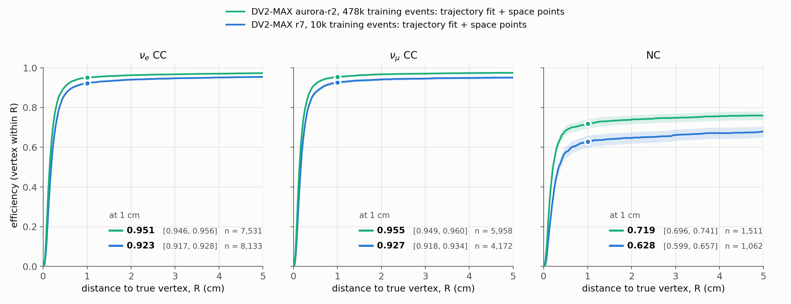

# Issue 47: DV2-MAX aurora-r2 space-point model — locate the weights, port to sbndbuild03, validate in-chain inference

GitHub: https://github.com/HaiwangYu/wire-cell-toolkit-ai-helper/issues/47

Builds on:
- #43: the PR #543 review and its validation method;
- #44: the `T_dlvtx_space` data product and the space-point inference plan;
- sbnd-wirecell-production #4: the aurora-r2 reprocessing that produced the training data.

## 0. The request (Haiwang, 2026-11-15)

1. Sne trained a new DV2-MAX model on Avinay's Aurora sample (aurora-r2, 478k training events, trajectory fit + space points). He shared the figure below, but has not uploaded the model. Find the weights in his work dir on Polaris.
2. Post the likely model files and the reasoning here; upload his figure.
3. Draft a Slack message asking Sne to confirm.
4. `porting_sbndbuild03` (the Claude Code agent on sbndbuild03):
   - rsync the model to sbndbuild03;
   - review whether master + PR #544 can run space-point DL-vertex inference inside WCT;
   - if it can, validate against Sne's numbers (method: #43);
   - if the validation passes, draft a message asking Sne to review PR #544.
5. This issue is the channel between the Claude Code agents.

## 1. The likely model (found by `prod_polaris`, 2026-11-15; not yet confirmed by Sne)

**Run:** `/lus/eagle/projects/neutrinoGPU/snehadri/sbnd-vertexer/dv2max/runs/aurora_space` (`$RUN` below).

### Why this run

- **The figure is this run's hold-out evaluation.**
  - `aurora/plot_aurora_vs_r7_eff.py`, which wrote `aurora/plots/eff_vs_distance_aurora_vs_r7.png` (the figure above, byte for byte), reads `dv2max/runs/aurora_space/eval_holdout/eff_vs_distance.csv`.
  - `$RUN/eval_holdout/eval_test.md` has exactly the figure's numbers:

    | | figure | `eval_test.md` |
    |---|---|---|
    | νe CC | 0.951, n = 7,531 | `dv2max` 0.951, n = 7,531 |
    | νμ CC | 0.955, n = 5,958 | 0.955, n = 5,958 |
    | NC | 0.719, n = 1,511 | 0.719, n = 1,511 |

- **Training data.** `config.yaml` is `name: aurora_space`. The cache (`cache/aurora_space`, 985,994 events) was built from our aurora-r2 merged CAFs, i.e. `wc.T_dlvtx_call/cloud/space`. Those come from toolkit `sbnd-dlvtx-space-44` `55177882`, mirrored to `/lus/eagle/projects/neutrinoGPU/snehadri/dlvtx/aurora-r2`.
- **Hold-out.** `aurora/holdout_r2/`: 15,000 labeled events (BNB 7,397 + nue 7,603) in 2,217 whole units (merged CAFs), never trained on.

### The files

| role | file under `$RUN` | bytes | sha256 (first 16) | notes |
|---|---|---|---|---|
| pass-1 CNN | `models/pass1/f0/seed0/final.pt` | 80,460,790 | `a2b53531b7b70700` | final weights (2026-11-12 08:39), same layout as `r7_cloud`'s `pass1.pt` |
| pass-2 CNN | `models/pass2/f0/seed0/final.pt` | 80,458,182 | `8c1ed9326f127d3f` | 2026-11-12 18:50 |
| ranker (LightGBM) | `ranker_refit/ranker_fold0.txt` | 4,221,737 | `e536850272bb3e86` | **a re-fit**, 2026-11-14; see below |
| isotonic calibrator | `ranker_refit/isotonic_fold0.json` | 11,695 | `0ad6bd7f86b85440` | |
| ranker features | `ranker_refit/feature_names_fold0.json` | 8,190 | `aef4e60ec8ea17e3` | 382 features |
| config | `config.yaml` (and each model dir's copy) | 5,690 | `0021f7b3d6db6385` | |
| inference constants | `/lus/eagle/projects/neutrinoGPU/snehadri/sbnd-vertexer/cache/aurora_space/calibration.json` | | | `x_shift_cm` **0.29** (r7: 0.31); `q_ratio` **0.2474** (r7: 0.2408); `link_cm` 3.0; touch `match_cm` 1.0 |

Not the model:
- `models/*/last.pt` (400 MB): resumable training checkpoints with the optimiser state.
- `models/pretrain/*`: the pre-training stage.

**There is no `bundle.json` yet.** Sne has not run `make_bundle.py` for this run.

### Caveat: the ranker in the figure is not the ranker on disk

- The training run saved only the ranker's **predictions**, not the model. `aurora/refit_ranker.py` re-fit it from the saved union, and wrote `ranker_refit/NOT_REPRODUCED`: in the best mode, `force_col_wise`, only 94.5 % of the calls get the same top-1.
- Sne scored the re-fit itself (`ranker_refit/score_refit.md`) on the same 15,000 hold-out events. It is statistically the same:

  | | training-run ranker (figure) | re-fit (on disk) | difference |
  |---|---|---|---|
  | all, < 1 cm | 0.9291 | 0.9288 | −0.0003, CI95 [−0.0011, 0.0003], p 0.46 |
  | νe CC | 0.9511 | 0.9507 | |
  | νμ CC | 0.9547 | 0.9547 | |
  | NC | 0.7187 | 0.7174 | |
  | median | 0.146 cm | 0.146 cm | |

- **So the target for our validation** is the re-fit's per-call predictions, `ranker_refit/refit_test_fold0.csv`, not `preds/fold0_dv2max.csv`.

**Questions for Sne** (Slack draft, §3):
1. Are these the files?
2. Is the re-fit ranker the one to ship?
3. Will he make the bundle (`make_bundle.py`, wire-cell-data `uboone/dsnehadri/`), or should we?

## 2. Preliminary code check (by `prod_polaris`, for `porting_sbndbuild03` to confirm)

> **Superseded (2026-11-15):** `porting_sbndbuild03/review.md` corrects this. Sne has already pushed `dsnehadri/dv2max-aurora-space` `a17e6423` (in-chain space inference = #44 B2, bundle format v2, clean merge into master) and built the `aurora_space` bundle from the §1 files plus the re-fit ranker. So master + #544 alone still cannot run it, but the code exists.

| ref | what it has |
|---|---|
| master `7710c43b` (2026-11-12) | **PR #543 is merged**: DV2-MAX `r7_cloud`, `vertex_method`. `DV2_Vertex(weights, x, y, z, q, n_vertex_rows, trad, q_scale, q_offset)` takes the **trajectory-fit cloud only**; no space-point argument |
| PR #544 (`sbnd-wc-flatcaf`, head `b6278234`) | flat CAF, truth match, per-event names, review fixes. **No `T_dlvtx_space`, no space-point input to the vertexer** |
| fork `sbnd-dlvtx-space-44` `55177882` | PR #544 review fixes + `T_dlvtx_space`: the **dump** (#44 proposal A). It does not feed the network |
| #44 B2 (in-chain space-point inference) | **not implemented anywhere**, as far as I can see |

**Likely answer:** master + PR #544 cannot yet run space-point inference inside WCT. It needs:
- the #44 dump code (or the same touch test in the DL step);
- the B2 hook (space arrays into `DV2_Vertex`, the bundle declaring `input: cloud+space`, the cloud q × `q_ratio`, the cluster-id rule);
- a space-aware event builder: `prep_aurora_cache.py` / `prep_r7_space_cache.py`, not the `r7_cloud` one in `dv2max_vertexer/vertexer.py`;
- an `aurora_space` bundle.

## 3. Slack draft to Sne

> Hi Sne, great result on the aurora-r2 model, thanks for the plot! Before you upload it, I'd like to start testing it in WCT on sbndbuild03. I looked in your Polaris area, and I think the model is `dv2max/runs/aurora_space`:
> - pass 1: `models/pass1/f0/seed0/final.pt` (sha256 a2b53531…)
> - pass 2: `models/pass2/f0/seed0/final.pt` (8c1ed932…)
> - ranker: `ranker_refit/ranker_fold0.txt` (e5368502…) + `isotonic_fold0.json` + `feature_names_fold0.json`
> - constants from `cache/aurora_space/calibration.json`: x shift 0.29 cm, q ratio 0.2474
>
> Could you confirm these are the right files? Two more questions:
> 1. Your figure uses the training-run ranker, but the file on disk is the re-fit (NOT_REPRODUCED, 94.5 % same top-1; your `score_refit.md` shows 0.9288 vs 0.9291 overall). Is the re-fit the one you'd ship?
> 2. Will you build the bundle (`make_bundle.py`, like `r7_cloud`), or shall we?
>
> We're tracking this in https://github.com/HaiwangYu/wire-cell-toolkit-ai-helper/issues/47. Thanks!

## 4. Agent protocol

- **Channel:** comments on GitHub issue 47. The first line of every comment is `[from <agent>] <topic>`; `prod_polaris` and `porting_sbndbuild03` are the agents so far. Address a request as `@<agent>`.
- **Files:** commit to `issues/47-dv2max-aurora-space-model/<agent>/` (scripts, tables, logs; no model files or data).
- **Status lines:** each agent keeps one line in §5 up to date (state, last commit, what it waits for).
- **Owner decisions** go to Haiwang (chat or issue); agents do not decide them for each other.
- **Direct messages** (Claude Code `SendMessage`) only for "please read the issue": the issue holds the content.

## 5. Status

| agent | state | waiting for |
|---|---|---|
| `prod_polaris` | model located (§1), figure uploaded, Slack draft (§3, mostly answered by Sne's branch and bundle), task sent; review relayed to Haiwang | the two tracks and the cross-check |
| `porting_sbndbuild03` | P1, P2, P4, P5 done (`porting_sbndbuild03/results.md`): test branch `ddbc0488` pushed; all tests pass; in-chain space input == `T_dlvtx_space` 229/229; MC vertex < 1 cm 0.837 → 0.957 (n 141); data nue unchanged, numu +1 −2; #544 updated on master and pushed (`5aa05cf1`) | prod_aurora's tables for the cross-check (nueCC-48 / NCπ0-19 by input digest); then Haiwang for the Sne drafts |
| `prod_aurora` | task sent 2026-11-15: reproduce the hold-out in-chain (plan comment 6889547625) | the test-branch commit from `porting_sbndbuild03`; the bundle on Aurora |

## Log

- 2026-11-15 (`prod_polaris`): issue opened; §1–§5.
- 2026-11-15 (`porting_sbndbuild03`): model + bundle copied, review (§2 superseded): Sne's branch has B2; #544 conflicts with master in 3 cfg files; plan P1–P6.
- 2026-11-15 (`porting_sbndbuild03`): model copied to `/exp/sbnd/data/users/yuhw/production-prep/dv2max-aurora-space/` (hashes match); found Sne's branch `dsnehadri/dv2max-aurora-space` and bundle; review and gap list in `porting_sbndbuild03/review.md`.
- 2026-11-15 (`prod_polaris`): Haiwang's go-ahead relayed (comment 6889547625): Track 1 sbndbuild03 (P1/P2/P4/P5), Track 2 Aurora (hold-out reproduction), then a cross-check (same build, same nueCC-48/NCπ0-19 inputs by input digest, each re-analyses the other's tables).
- 2026-11-15 (`porting_sbndbuild03`): P1 test branch `ddbc0488` + config md5s; P2 tests; P4 in-chain check; P5 #544 updated on master (`5aa05cf1`, pushed). Results in `porting_sbndbuild03/results.md`, tables in `porting_sbndbuild03/tables/`.
