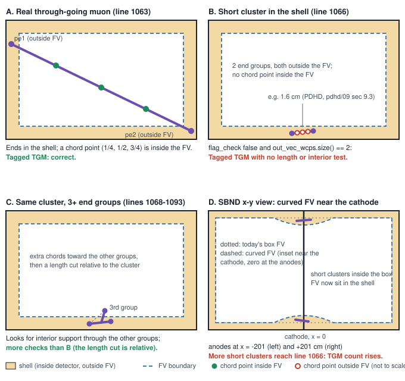

# Issue 50: an optional non-box effective boundary for SBND (plan for Sne)

Author: `porting_sbndbuild03`, 2026-11-17. This is a plan only: no WCT code was changed.

Background material, all in `porting_sbndbuild03/`:
- `paper-notes.md`: verbatim extracts of arXiv 2101.05076 §V.
- `prototype-survey.md`: the MicroBooNE prototype (`ToyFiducial`, `Cosmic_tagger.h`).
- `wct-survey.md`: the WCT 0.38.0 boundary code, with file:line references.

Paths below are relative to the toolkit tree unless absolute.

## 0. Summary

- **The machinery already exists in WCT.**
  - `PolyFiducial` (`aux/src/PolyFiducial.cxx`) stacks polygon slabs along one axis. Its header says it is the port of the prototype's `ToyFiducial`.
  - `CompositeFiducial{logic:'and'}` (`aux/src/CompositeFiducial.cxx`) combines an x–y polygon and an x–z polygon. That is the paper's two-projection test.
- **PDHD is a ready template.** PDHD has two drift volumes mirrored about a cathode at x = 0, like SBND.
  - It ships a default-off `curved_fv` knob: `pdhd/curved_fiducial.jsonnet`, `curved_fiducial_profiles.jsonnet`, and `pdhd/pr.jsonnet:1415-1447`.
  - Its surface comes from a cosmic exit-end census (doc `pdhd/09`, which ports doc `pdvd/43`).
  - It has been PDHD production since 2026-09-07, at the exit-gap 90th-percentile surface plus a 3 cm cushion ("p90 + 3").
  - PDVD has the same mechanism.
- **SBND needs:**
  1. an SBND port of that jsonnet, with one profile set per TPC;
  2. one knob in `sbnd/clus.jsonnet` `pr()`, default off, so compiled configs stay byte-identical;
  3. a measured SBND surface, made with the PDHD census method on SBND cosmics, data and MC separately;
  4. doctests for the polygon fiducials;
  5. the gates in §5.
- **No C++ change is needed for the cosmic taggers.** Every consumer reaches the boundary through `IFiducial::contained`.

## 1. Where SBND's boundary comes from

The paper gives no coordinates (§V.A), and the prototype's numbers are MicroBooNE's: one TPC, cathode at 256 cm, 273 V/cm. **SBND must measure its own.**

**Sne builds the data and MC shapes** (Haiwang, 2026-11-17); Sne has the data and chooses the method. §1.1 describes one proven method, as a suggestion.

### 1.1 A suggested method: an exit-end census on SBND cosmics

This is the method of doc `pdhd/09` §5–7, which ports doc `pdvd/43`. The doc and its `d09_*` scripts are in the private repo `WireCell/wcp-porting-validation` (repo access is Haiwang's call). Readable copies, identical to `origin/main`:
- **Polaris (ALCF, neutrinoGPU group):** `/lus/eagle/projects/neutrinoGPU/yuhw/wcp-porting-validation/pdhd/docs/09_pdhd-space-charge-fiducial.md` and `…/pdhd/docs/scripts/d09_*.py`.
- **FNAL:** `/exp/sbnd/app/users/yuhw/wcp-porting-img/pdhd/docs/09_pdhd-space-charge-fiducial.md`. It is the paper's §V.A done with an end-point estimator:
- **Ends:** every end of every long (> 2 m, ≥ 40 points) cluster that is matched to light, in T0-corrected reconstructed coordinates. These are the coordinates the SBND taggers use (`sbnd/clus.jsonnet:104-110`).
- **Assign each end to one wall:** the first of the six planes that a ray from the end, along the track's outward direction, crosses. Record the signed perpendicular gap.
- **Exclude:** ends at the readout-window edges, which are incomplete. Subtract the flat non-exit floor.
- **Bin in drift distance |x|**, per TPC and per wall. Take a gap quantile per bin.
  - PDHD found p80 worse than the flat box and p90 best.
  - Regularize so the inset does not increase toward the anode (PAV), and bootstrap over ends (300).
- **Grade with the held-out exit-end miss rate:** of the ends that really exit, the fraction the boundary calls contained (`pdhd/09` §7). Use the miss rate on an independent run to pick the quantile and cushion.
- **Scripts:** the `d09_*` scripts named in `pdhd/09` §0 (on Polaris: `/lus/eagle/projects/neutrinoGPU/yuhw/wcp-porting-validation/pdhd/docs/scripts/`) (`d09_exit_census.py`, `d09_quantile_surface.py`, `d09_quantile_offline.py`, `d09_fv_pdhd.py`). They hold PDHD-specific constants (§1.3) that the port must replace.

### 1.2 Samples

| | data | MC |
|---|---|---|
| sample | SBND off-beam ("beam-off", InTime-Run1) data: only cosmics, and a known set | the Gen2 BNB CV MC, which includes CORSIKA cosmics (`prodgenie_corsika_proton…`) |
| building | **only the training half** `WCLocal2026Nov16/beam-off-train` (odd runs) | any CV subset |
| grading | `beam-off-eval` (even runs) and/or a Run-3 BNB subset, so the surface is graded on runs it was not built from | a second, disjoint CV subset |
| what it shows | the real space-charge distortion and imaging edges, including the suspected defective regions near the cathode | the simulated space charge, limited by this round's simulated range |

- **Inputs:** the WCLocal2026Nov16 outputs (#48) already hold reconstructed clusters for all of these, through the tracking-pr tars and the qlpctree tars (`lists/*-scratch.txt`). For the census, only step 2 (clusters and Q/L) is needed, rerun with debug output.
- **Space charge (answered by Haiwang, 2026-11-17):**
  - **The Gen2 MC simulates space charge,** and data is assumed to have a similar distortion.
  - **The boundary is applied in reconstructed space, after space charge, with no back-correction.** Every downstream algorithm was built on uncorrected positions, so no correction is attempted for now. This matches the reconstruction: SBND runs with `use_sce:false` for data and MC (`sbnd/clus.jsonnet:921-925`).
  - **Data and MC each need their own boundary shape**, because the two differ at the boundary:
    - **MC:** the simulated range is not large enough in this round.
    - **Data:** there seem to be defective regions near the cathode, the DENT. Whether to exclude it this round is the question for Xin in §7.
  - **Sne has the data and builds both shapes.** The census in §1.1 is the suggested method; Sne decides the method and the samples.
  - So a "flat MC" closure test does not apply. The MC shape is a measurement in its own right.
- **Expected size:** SBND drifts 2 m at 500 V/cm. MicroBooNE drifted 2.56 m at 273 V/cm with more space charge per cm. Expect a smaller inset than MicroBooNE's 10–40 cm, but measure it.
  - `SCEoffsets_SBND_E500_dualmap_CV_voxelTH3.root` (`sbnd/clus.jsonnet:66`) gives a predicted displacement map. Use it as a cross-check of the measured shape, not as the boundary.
- **Statistics gate:** at least 20 in-window exit ends per (TPC, wall, |x| bin). List any starved bins by name, as `pdhd/09` §6 does. Expect the z walls to be the starved ones, because cosmics run along y.

### 1.3 SBND constants for the port

| | SBND | source |
|---|---|---|
| anode face, both TPCs (`XW`) | 201.05 cm | `sbnd_pr_fv` box, `sbnd/clus.jsonnet:2500-2509` |
| y walls | ±199.312 cm (symmetric, like PDVD's) | the same box |
| z walls | 0.85 / 500.15 cm | the same box |
| cathode face (`CATH`) | 2.5 cm (per-face `FV_x` inner edge, `sbnd/clus.jsonnet:148-149, 170-171`) | |
| volume keys | `_tpc0` (x < 0, APA 0) and `_tpc1` (x > 0, APA 1), replacing PDHD's `_g02` / `_g13` | |
| drift bins | 4 × ~50 cm per TPC; refine if statistics allow | |
| readout-edge exclusion | the SBND readout window's raw-x early/late extremes, **measured** from the qlpctree raw x (as `pdhd/09` §5 did) and checked against ticks × drift speed | |

### 1.4 Who does what

| step | who | notes |
|---|---|---|
| does the Gen2 MC simulate space charge? | answered: yes (Haiwang) | §1.2 |
| build the data and the MC boundary shapes (Sne has the data) | **Sne** | §1.1 is a suggested method, e.g. the census scripts ported to SBND constants (§1.3) |
| run step 2 with debug output on `beam-off-train`, the eval subset and a CV subset, if needed | Sne; porting_sbndbuild03 can run it on FNAL (the #48 workflow) on request | inputs from #48 |
| pick the quantile and cushion | **Sne decides** | PDHD chose p90 + 3 cm (`pdhd/09` §7, §9.6), for reference only |
| **interim boundary** | none needed: the knob ships default off, and its `flat` profile reproduces the current box (§2.3). No unmeasured curved boundary is switched on. | |

## 2. How it fits the PolyFiducial / CompositeFiducial / `curved_fv` path

### 2.1 Geometry: one polygon pair across both TPCs, with per-TPC profiles

- **One polygon pair, not two volumes.** Use one x–y polygon and one x–z polygon spanning both TPCs, continuous across the cathode, exactly as the `sbnd_pr_fv` box does today (`sbnd/clus.jsonnet:2494-2499`) and as PDHD does. A cathode-crossing track must not count as an exiter at x = 0.
  - Two separate volumes would reintroduce the cathode hole that `sbnd_pr_fv` was created to avoid.
- **Per-TPC profiles, not mirrored.** Each wall of each TPC is a knot list `[[|x|, inset], …]` from the anode face to the cathode face: 8 profiles (y+, y−, z+, z− × tpc0, tpc1). These are PDHD's `side()` / `knots()` construction (`pdhd/curved_fiducial.jsonnet:100-147`).
  - The two TPCs have separate space-charge maps (`sce_field` per APA, `sbnd/clus.jsonnet:167`) and separate electronics.
  - Mirroring (tpc1 := tpc0) is an allowed fallback **only** when the per-TPC surfaces agree within their bootstrap errors, or when a TPC's bins fail the statistics gate. Record which was used.
- **The inset is zero at the anode by construction** (`x2 ≤ XW`), as the PDHD file requires.
- **z-dependence (paper Fig. 11):**
  - v1 uses one slab per projection, the inner envelope over z (the paper's "conservatively … the inner boundary of all Z-slices").
  - Z-binned x–y slabs (several slabs in one `PolyFiducial`, axis 2) are a v2 option, needed only for a light-mismatch-style use (§4, Q/L).
  - Watch two things with multiple slabs: the slabs inside one `PolyFiducial` are OR-ed with inclusive edges, and the `m_bb` short-circuit (`aux/src/PolyFiducial.cxx:139`) rejects anything past the slab span.

### 2.2 Files

- **New `cfg/pgrapher/experiment/sbnd/curved_fiducial.jsonnet`:** a port of `pdhd/curved_fiducial.jsonnet`. Change the constants (§1.3), use symmetric y walls (`±YW`, as in PDVD's version), and rename the keys to `_tpc0` / `_tpc1`.
  - It returns `{polys, composite, tn, configs, boundary_xy, boundary_xz}`.
  - It has a `profile=null` argument; `null` gives the flat walls, i.e. exactly the `sbnd_pr_fv` box.
  - **Corner order:** axis 2 → (x, y); axis 1 → (z, x) (`aux/src/PolyFiducial.cxx:62-68`). PDHD's file already does this.
- **New `cfg/pgrapher/experiment/sbnd/curved_fiducial_profiles.jsonnet`:** the measured knot lists, generated by the census, one entry per chosen surface (for example `p90`), with data and MC entries if they differ. Its header lists starved bins.
- **`sbnd/clus.jsonnet` `pr()`:** the knob (§3).
- **Drivers** (`sbnd/wct-pr.jsonnet`, `sbnd/wct-pr-perevt.jsonnet`, `sbnd/wcls-img-clus-matching-pr-lib.jsonnet`): pass the knob through as TLAs whose defaults are the off values.

### 2.3 Margins and cushion

- **SBND is not like PDHD here.** PDHD's production box carried a flat 15 cm space-charge shell that the surface replaces, which is why PDHD drops its y/z margins to the cushion when `curved_fv` is on.
- SBND's `sbnd_pr_fv_margins` (`sbnd/clus.jsonnet:2521, 2533`: x 2.5, y 3, z_max 5, z_min 3 cm) are a small tolerance band, about the prototype's tagger band (`Cosmic_tagger.h:34-36`, 2.2–2.8 cm). They are not a space-charge allowance.
- **Proposed default:** with the knob on, keep `fv_tolerance` = the current SBND margins (the band), and put space charge and the cushion into the vertices.
  - Expose `curved_fv_margin_y/z` as in PDHD, but default them to the current `tgm_fv_y_margin` / `tgm_fv_zmax_margin`, so that "knob on + flat profile" equals today's box exactly.
  - Whether the band should shrink once the surface is in is a decision for after the before/after comparison (§5), not part of v1.
- **Tolerance semantics:** WCT moves the probe point by the tolerance; it does not move the polygon edge (`clus/src/FiducialUtils.cxx:79-119`). On a slanted edge that differs slightly from the prototype's vertex inset, so a cushion that must be exact goes into the vertices (`cushion_*` arguments).

## 3. The knob, and keeping compiled configs byte-identical

In `sbnd/clus.jsonnet` `pr()`, copying `pdhd/pr.jsonnet:1415-1447`:

```jsonnet
// arguments (defaults = off)
curved_fv=false, curved_fv_profile='flat',
curved_fv_margin_y=null, curved_fv_margin_z=null,   // null => tgm_fv_y_margin / tgm_fv_zmax_margin

local curved_fv_cfg = (import 'pgrapher/experiment/sbnd/curved_fiducial.jsonnet')(
    name_prefix='sbndcurved',
    profile=(if curved_fv_profile == 'flat' then null else curved_fv_profiles[curved_fv_profile])),
local sbnd_pr_fv_box = { type: 'BoxFiducial', name: 'sbnd_pr_fv', data: { ... unchanged ... } },
local sbnd_pr_fv      = if curved_fv then curved_fv_cfg.composite else sbnd_pr_fv_box,
local sbnd_pr_fv_uses = if curved_fv then curved_fv_cfg.configs   else [sbnd_pr_fv_box],
```

- **Keep the box's `name: 'sbnd_pr_fv'`.** Every consumer refers to `wc.tn(sbnd_pr_fv)`, so off must still resolve to `BoxFiducial:sbnd_pr_fv`.
- **Replace `[sbnd_pr_fv]` with `sbnd_pr_fv_uses`** in `tagger_uses` (`sbnd/clus.jsonnet:3183-3197`). That is the only other edit; every tagger already reads `sbnd_pr_fv`.
- **Margins:** `local mgn_y = if curved_fv && curved_fv_margin_y != null then curved_fv_margin_y else tgm_fv_y_margin` (and the same for z). The vector at `:2521` / `:2533` uses `mgn_*` but evaluates to the old expression when off.
- **Why off is byte-identical:** an imported but unused `local` emits nothing, and every off branch is the old literal.

**How it is checked (gate G1):**
1. Compile each SBND driver before and after the change, with the knob absent and with `curved_fv=false` given explicitly, for sim and data and both production vertex passes.
   - Drivers: `wct-pr.jsonnet` with the production TLAs (as `#48 porting_sbndbuild03/scripts/config-md5.sh` does), `wct-pr-perevt.jsonnet`, and `wcls-img-clus-matching-pr-lib.jsonnet` through its fcl wrapper.
2. `cmp` the JSON outputs, and record the normalized md5s (that script's method). **Every one must be identical.**
3. Record the table in the issue, as `pdhd/09` §10 does.

**Gate G2, knob on with the flat profile:** the compiled config differs (a composite instead of a box), but the tagger results must equal the box on the §5 samples. Compare per cluster: TGM, STM and FC flags, and the neutrino-tagger flags.
- Exact equality is expected. Any difference must be traced to a point that lies exactly on a wall, where `pnpoly` and `BoundingBox::inside` treat the edge differently, and documented.
- This proves the plumbing before any measured surface is used.

## 4. Consumers: what switches

Three kinds of boundary exist in SBND today (`wct-survey.md` §1–3):
- **(a)** the tagger box `sbnd_pr_fv` with its margins;
- **(b)** the FiducialUtils volume `fiducial=dv`: the union of the sensitive volumes, no margin, with a hole at the cathode;
- **(c)** the `FV_*` numbers in the DetectorVolumes metadata (box only, not an `IFiducial`).

The knob changes (a) only.

| consumer | today | v1 (knob on) | why |
|---|---|---|---|
| **TGM**: `TaggerCheckTGM` `inside_fv` / `inside_fv_interior` (end points, chord midpoints, prolonged-signal check, neutrino-candidate apex) | (a) | **must switch** | the purpose of the issue (paper §V.B) |
| **STM containment gate** (`cluster_fc_check` in `clus/src/TaggerCheckSTM.cxx:3620`, `stm_consistent_fv=true`) | (a) | **must switch** (automatic) | paper §V.C "exactly one extreme point outside" |
| STM internal tests: kink search, internal TGM, one-end-outside, `check_dead_volume` | (b) | **leave** in v1; optional v2 via a second knob | they read FiducialUtils; switching it moves the dead-volume / signal-processing walk termination for every consumer (§4.1) |
| STM `dist_to_anode`, `cathode_guard_reject` | box faces (`inner_bounds`) | **leave** | distances to the physical planes, not a containment test |
| **FC tag** (`TaggerCheckFC`) | (a) | **must switch** (automatic) | "contained" must keep one meaning for TGM and FC (`sbnd/clus.jsonnet:2513-2516`) |
| neutrino `match_isFC` (`clus/src/TaggerCheckNeutrino.cxx:4580`) | (a) | **must switch** (automatic, `neutrino_consistent_fv=true`) | the same definition |
| **cosmic tagger** `cosmic_tagger` flags 1–10 (`clus/src/NeutrinoTaggerCosmic.cxx:504-571`) | (a), `cosmic_consistent_fv=true` | **switches** (automatic); validate | the prototype used its polygon here too (`NeutrinoID_cosmic_tagger.h`); these are BDT inputs (`cosmict_*`) |
| **nue / single-photon tagger** `angular_cut`, `shower_to_wall`, `bad_reconstruction_2(_sp)` | (a), `nue_sp_consistent_fv=true` | **switches** (automatic); validate | BDT inputs (`br3_2_other_fid`, the shower-to-wall family) |
| BDT / kinematics inputs generally | follow the taggers above | **validate**, no separate switch | the BDT weights are MicroBooNE-trained on a polygon-based boundary, so a polygon may be closer to the training. §5 compares the input distributions. |
| PR in-volume checks: `break_two_end_dqdx` (`clus/src/NeutrinoPatternBase.cxx:3041`), vertex finder (`clus/src/NeutrinoVertexFinder.cxx:1260, 1314, 2188, 4455, 4558, 5348`) | (b) | **leave** | these ask whether a point is in the detector during reconstruction, not cosmic rejection; switching them moves vertexing |
| dead-volume / signal-processing walks (`FiducialUtils::check_*`) | (b) | **leave** in v1 | §4.1 |
| **neutrino-candidate FV for analysis** (selection cut on the reco vertex) | analysis-side box | **optional**, the analysts' call | the paper defines FV = 3 cm inside the effective boundary (§V.A). Providing `curved_fv_cfg` with a 3 cm cushion as a named volume is cheap; adopting it is an analysis decision. |
| **Q/L matching**: `inner_bounds` run bounds, `at_x_boundary`, `close_to_PMT`, `cathode_fiducial` (`clus/src/QLMatching.cxx:1475-1505, 5175-5241`) | box + CPA exclusion | **leave** in v1; v2 candidate | the paper's light-mismatch use (§V.D) needs the **z-dependent** boundary (Fig. 11), i.e. z-binned slabs (§2.1). That is a separate project with its own Q/L validation. |
| clustering metadata FV (`select_scope_fv`, `clustering_separate`, `clustering_examine_x_boundary`, `clustering_neutrino`) | (c) | **leave** | box numbers, not an `IFiducial`; changing them needs C++ and moves clustering |
| **truth containment**: labeler `pf_fiducial` = `fiducial_box()` (`sbnd/clus.jsonnet:3461-3474`) | box | **leave on box** | truth containment defines efficiency denominators and must not depend on the reco-space distortion |

### 4.1 The second knob (v2, optional)

Pointing `MakeFiducialUtils.fiducial` (`common/clus.jsonnet:1728-1736`, set from `dv` at `sbnd/clus.jsonnet:2464-2467`) at the curved composite would switch every (b) site at once, including the STM internal tests and the walks. Two cautions:
- The walks step until the point leaves the volume. A curved volume ends them earlier near the cathode corners, which changes `check_dead_volume` and `check_signal_processing` for TGM, FC and STM together.
- `dv` currently also provides the cathode hole, and some walk logic may rely on it.

If it is ever wanted, it should be a separate default-off knob with its own A/B. **Not part of v1.**

## 5. Tests

### 5.1 Doctests (C++ tests only; no library change)

In `aux/test/doctest_fiducials.cxx`, which today covers only `BoxFiducial` and a single-slab `PolyFiducial`:
1. **Multi-slab `PolyFiducial`:** OR across slabs, inclusive slab edges, the `m_bb` short-circuit, and the corner order for axis 1 vs axis 2.
2. **`CompositeFiducial` `and` / `or`:** an x–y and an x–z polygon. A point inside both is contained; a point outside either is not.
3. **The flat SBND profile equals the box:** points on a grid, including on the walls, give the same `contained` for the flat composite and for `BoxFiducial:sbnd_pr_fv`. This pins G2 at the unit level and documents the on-wall convention.
4. **The 6-probe tolerance against a polygon** (`FiducialUtils::inside_fiducial_volume` with a size-6 vector): a negative tolerance near a slanted edge shrinks the volume, and the index-4/5 z convention matches `sbnd/clus.jsonnet:2510-2512`.

Plus a jsonnet check, a small `jsonnet -e` or `wcsonnet` assertion in the test suite:
- the SBND `curved_fiducial.jsonnet` polygons are closed, wind consistently and stay inside the box;
- `profile=null` reproduces the box corners;
- every profile in `curved_fiducial_profiles.jsonnet` has inset 0 at the anode.

### 5.2 Gates on samples

**Samples:**
- the #43 MC tars and nueCC-48 + NCπ0-19: the step-1 tars at `/exp/sbnd/data/users/yuhw/production-prep/pr543-review/inputs/`, the same set as #48 P1, run with the production step-2 TLAs (`#48 porting_sbndbuild03/scripts/run-step2.sh`);
- plus, for the boundary itself, the held-out cosmic samples of §1.2.

| gate | arms | pass |
|---|---|---|
| **G1** byte identity | knob absent; `curved_fv=false` | compiled JSON identical (`cmp`) for every driver, reality and pass (§3) |
| **G2** plumbing | knob on, `flat` profile vs knob off | identical per-cluster TGM, STM and FC flags and neutrino-tagger flags; identical `recTreeWireCell` apart from documented on-wall points |
| **G3** physics | knob on, measured profile vs off, on the #43, nueCC-48 and NCπ0-19 samples | a per-event table of TGM, STM and FC tags, the selected neutrino cluster, and the `cosmict_*` / `br*` / shower-to-wall BDT inputs. Every changed event explained (a Bee scan of a sample of them); no crash or new "DL vertex failed"; ν_e / NCπ0 signal efficiency on the MC not lowered beyond a stated tolerance. |
| **G4** boundary quality | the measured surface vs the box, on held-out data (`beam-off-eval`) | exit-end miss rate (`pdhd/09` §7) lower than the box's, overall **and** in the cathode half (the box's known imbalance); long-track (> 2 m) TGM count not lower |
| **G5** data vs MC | the data shape vs the MC shape, wall by wall | the differences are explained: MC's limited simulated range, data's defective regions near the cathode (§1.2) |

### 5.4 TGM: short clusters lying in the cushion are tagged (accepted)



**What the code does.** `TaggerCheckTGM::check_tgm()`, CASE A (`clus/src/TaggerCheckTGM.cxx:1024-1096`):
- When both end points of a cluster are outside the FV, the tagger tests three points on the chord between them (¼, ½, ¾).
  - If one is inside the FV, the cluster crosses the detector and is tagged (line 1063, panel A).
  - If none is, the chord lies entirely in the shell between the FV boundary and the wall. **With exactly two end groups, the cluster is tagged straight away** (line 1066, `if (out_vec_wcps.size() == 2) return true;`, panel B). There is no length cut and no interior-support test.
  - With three or more groups, the code first looks for interior support through the other groups and applies a length cut relative to the cluster (lines 1068-1093, panel C).
- The three CASE-A guards that run first are all on in the SBND production defaults (`cfg/pgrapher/experiment/sbnd/clus.jsonnet:1218-1221`). They reject pairs with no charge path between the ends, rescued-end pairs without straight-chord support, and fragment-only pairs. A short, connected cluster in the main component passes all three.
  - `require_chord_charge` (`tgm_chord_charge`, mode `path`);
  - `rescue_chord_check` (`tgm_rescue_chord`);
  - `main_component_pairs` (`tgm_main_pair`, mode `real`).
- **This is the prototype's behaviour,** copied unchanged (`wcp/pid/src/Cosmic_tagger.h:1438-1441`). PDHD traced it on data (`pdhd/09` §9.3, §11): a 1.6 cm object tagged, and 49 % of PDHD's TGM tags under 10 cm.

**Why the non-box FV matters here (panel D).** The curved FV pulls the boundary in near the cathode, so the shell is thicker there. Short two-group clusters that are inside today's box can fall entirely into the shell and get tagged at line 1066.

**Decision (Haiwang, 2026-11-17): accepted, no code change.** Short clusters lying entirely in the cushion region are tagged TGM and removed, even when they are not really through-going. The extra loss is small and affordable.

For reading G3: the TGM count will rise partly from these short tags, not from more real through-going muons. So report TGM tags under 10 cm separately from longer ones, as PDHD did, to see how much of any change is this path.

### 5.3 Validation plan: three levels (Haiwang, 2026-11-17)

| level | what | who | maps to |
|---|---|---|---|
| **1** | Check each boundary shape (data and MC) against the data it was built from, visually or with a standalone script. The polygons must follow the observed edge of the track end points, including near the cathode, where the data seem to have defective regions. | Sne | §1, G4, G5 |
| **2** | Build or find input samples showing that the non-box boundary does change the cosmic taggers (TGM, STM, FC, and the neutrino tagger's cosmic flags), and that the changes are the intended ones. | Sne and porting_sbndbuild03 | G2, G3. porting can provide FNAL samples (the #48 beam-off train/eval and the #43 / nueCC-48 / NCπ0-19 tars) and run the before/after on sbndbuild03 or the grid. |
| **3** | Ask Prabhjot to rerun his simulation-vs-data comparison, to check the data–MC discrepancy in vertexing, especially near z ≈ 0 (the upstream wall). | Prabhjot (Haiwang asks) | after level 2, with the knob on in both data and MC |

## 6. Hand-off for Sne

**Implement, in this order** (each step is its own reviewable commit):
1. **Doctests 5.1(1, 2, 4)** for the existing `PolyFiducial`, `CompositeFiducial` and the tolerance probe. No behaviour change; they pin what follows.
2. **`sbnd/curved_fiducial.jsonnet`** with SBND constants and per-TPC keys (§1.3, §2.2), and the jsonnet check (§5.1). Nothing imports it yet, so configs are still byte-identical.
3. **The knob in `sbnd/clus.jsonnet` `pr()`** plus the driver TLAs (§3).
   - **Acceptance:** G1 (byte identity, recorded table) and G2 (knob on + flat = box on the §5.2 samples), and doctest 5.1(3).
4. **Build the data and the MC boundary shapes** with your data and your method; §1.1 (the `pdhd/09` census) is a suggestion.
   - Data and MC get separate shapes (§1.2). Grade the data shape on runs it was not built from (`beam-off-eval`).
   - **You choose the quantile and cushion.**
   - **Acceptance:** validation level 1 (§5.3): each shape matches its data visually or by script. Also G4, and G5 (data vs MC explained).
5. **Write `curved_fiducial_profiles.jsonnet`** with a data entry and an MC entry, selected by `reality` in `pr()`, which `pr()` already sees (`sbnd/clus.jsonnet:896`).
6. **Validation level 2 = G3** on samples that exercise the cosmic taggers. porting_sbndbuild03 can provide and run them (§5.3). Every changed event explained.
   - Then **level 3:** Haiwang asks Prabhjot to rerun the simulation-vs-data vertexing comparison, with attention to z ≈ 0.
7. Only then: propose turning the knob on in a production driver, as PDHD did in `wct-pr-perevt.jsonnet`. The `pr()` default stays off.

**Files:**
- **new:** `sbnd/curved_fiducial.jsonnet`, `sbnd/curved_fiducial_profiles.jsonnet`, the census scripts, test additions in `aux/test/doctest_fiducials.cxx` (plus `clus/test` for the tolerance probe);
- **edited:** `sbnd/clus.jsonnet` (`pr()` arguments, `sbnd_pr_fv` / `sbnd_pr_fv_uses` / `mgn_*`, `tagger_uses`), and the three SBND drivers (TLA pass-through);
- **not touched in v1:** any C++ outside tests; `MakeFiducialUtils`; Q/L; clustering metadata; the truth labeler.

**Open questions (for Haiwang / Sne):**
1. ~~Does the Gen2 MC simulate space charge?~~ **Answered (Haiwang):** yes. The boundary is applied after space charge, with no back-correction, and data and MC get separate shapes, built by Sne (§1.2).
2. Which quantile and cushion? **Sne decides.** PDHD chose p90 + 3 cm, for reference.
3. With the surface in, should the SBND tolerance band (2.5 / 3 / 5 / 3 cm) stay, or shrink? Default: stay (§2.3).
4. Per-TPC vs mirrored profiles if one TPC is short of statistics (§2.1).
5. Should the analysis neutrino FV adopt "3 cm inside the effective boundary" (paper §V.A)? That is the analysts' call (§4).
6. Is the z-binned boundary for Q/L (paper §V.D) wanted as a v2 project (§4)?
7. ~~The `clus/src/TaggerCheckTGM.cxx:1066` short-cluster path: fix it first?~~ **Decided (Haiwang):** no fix. Short clusters lying entirely in the cushion are tagged TGM, and that efficiency loss is acceptable (§5.4). Report sub-10 cm TGM tags separately in G3.

## 7. Item for Xin: the cathode DENT region in data

**Question (Haiwang, 2026-11-17):** real data has a DENT region at the cathode. The current FV does not treat the cathode as outside the FV. **For this round of the non-box FV, should we still ignore that region?**

**How the cathode is treated today:**
- **Tagger FV:** `sbnd_pr_fv` (`cfg/pgrapher/experiment/sbnd/clus.jsonnet:2494-2509`) is one box spanning both TPCs, so the cathode is inside the FV. A track that ends at, or crosses, the cathode is never an "exiter" there. This is deliberate (the comment at :2494-2499). The tagger margins inset only the two anode faces in x.
- **The planned curved FV keeps that** (§2.1, as PDHD does). Its x–y and x–z polygons are continuous across x = 0. Near the cathode they pull the y and z walls inward, but they do not exclude any slab around x = 0.
- **Other cathode handling:**
  - `FiducialUtils` (`fiducial=dv`) has a 0.45 cm hole at the cathode slab. It is used only by the auxiliary dead-volume and signal-processing walks inside TGM and FC, and those walks stop there.
  - `sbnd/cathode_fiducial.jsonnet` is a cathode-structure exclusion volume (the OR of 26 `BoxFiducial`s, from engineering drawings, 0.5 cm cushions). It is used only by Q/L matching (`cathode_fiducial` key, `wcls-img-clus-matching-pr-lib.jsonnet:277-291`).

**The two options:**

| | (a) ignore the DENT this round (proposed) | (b) exclude the DENT from the FV |
|---|---|---|
| change | none beyond the curved FV | data-only: `CompositeFiducial{and: [curved FV, NOT(dent boxes)]}`, as PDVD's `crp_gap_fiducial.jsonnet` excludes its measured gaps; no C++ needed |
| tracks ending in the DENT | contained, as today | exiters, so STM would not call a muon that stops there a stopper, and FC would call such an event not contained |
| tracks crossing it | unchanged | a chord test point in the DENT counts as outside the FV; TGM still tags them if another chord point is inside |
| needs | nothing | the DENT's measured extent in x, y and z, data only, since MC does not have it |
| risk | data–MC disagreement near the cathode stays; it shows up in validation level 3 | a new data-only boundary, and a data–MC asymmetry in what counts as contained |

**Suggested way forward:** (a) for this round. Sne's validation level 1 (§5.3) should mark the DENT on the data plots, so its location and size are recorded. Option (b) can then be a later, separate knob, reusing `cathode_fiducial.jsonnet`'s box-list pattern with measured dimensions.
